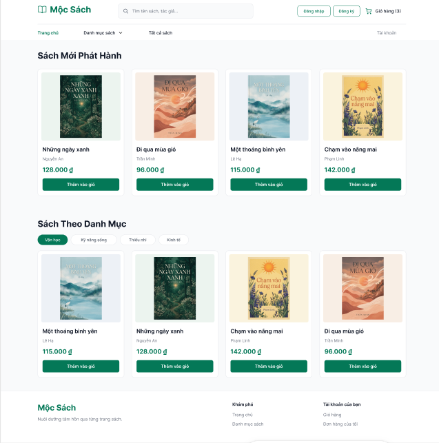

### Chương 1. Giới thiệu đề tài, mục tiêu, phạm vi _(TV1)_

- 1.1 Bối cảnh và lý do chọn đề tài (bán sách trực tuyến, COD)
  - Thương mại điện tử giúp cửa hàng nhỏ tiếp cận khách hàng mà không cần mở rộng mặt bằng, còn người mua có thể xem, so sánh và đặt hàng bất cứ lúc nào. Với mặt hàng sách, nhu cầu tìm kiếm theo tên, tác giả, thể loại và xem nhanh thông tin trước khi mua rất lớn, nên một website bán sách có giao diện dễ dùng là bài toán phù hợp để thực hành đầy đủ quy trình xây dựng ứng dụng web.
  - Đề tài chọn hình thức thanh toán khi nhận hàng (COD) vì đây là hình thức quen thuộc với người mua tại Việt Nam và giúp nhóm tập trung vào nghiệp vụ cốt lõi: giỏ hàng, đặt hàng, quản lý tồn kho và xử lý đơn, thay vì tích hợp cổng thanh toán.
- 1.2 Mục tiêu của dự án
  - <b>Mục tiêu chung:</b> xây dựng website thương mại điện tử bán sách chạy được trọn vẹn, có giao diện dễ sử dụng, hỗ trợ khách hàng mua sách và hỗ trợ quản trị viên quản lý sản phẩm, đơn hàng.
  - <b>Mục tiêu cụ thể:</b>
    - Khách hàng xem, tìm kiếm, lọc sách; thêm vào giỏ; đặt hàng COD; theo dõi và hủy đơn khi còn được phép.
    - Quản trị viên quản lý danh mục, sản phẩm, đơn hàng và người dùng.
    - Đảm bảo tính đúng đắn của dữ liệu: đặt hàng chạy trong transaction, tồn kho không âm, giá trong đơn không đổi khi giá sản phẩm thay đổi sau đó.
    - Đảm bảo các yêu cầu bảo mật cơ bản: băm mật khẩu, chống SQL Injection, XSS, CSRF, kiểm tra quyền phía server.
    - Về quy trình: làm việc theo Scrum rút gọn trên Trello, quản lý mã nguồn bằng Git/GitHub theo mô hình nhánh và Pull Request, sử dụng AI có ghi log và kiểm chứng.
- 1.3 Phạm vi: 3 phân hệ (khách vãng lai, khách hàng, quản trị); 12 chức năng bắt buộc TM-01 → TM-08, TM-11 → TM-14; chức năng cộng điểm đã làm TM-09,TM-16
  | Phân hệ | Người dùng | Mục đích |
  | ------- | ---------- | -------- |
  | Khách vãng lai | Người chưa đăng nhập | Xem, tìm kiếm sản phẩm; đăng ký |
  | Khách hàng | Người đã đăng nhập | Giỏ hàng, đặt hàng, theo dõi đơn, quản lý hồ sơ,đánh giá sản phẩm |
  | Quản trị | Chủ cửa hàng | Quản lý danh mục, sản phẩm, đơn hàng, người dùng,mã giảm giá |

### Chức năng bắt buộc (12 chức năng)

| Mã    | Chức năng              | Phân hệ        |
| ----- | ---------------------- | -------------- |
| TM-01 | Trang chủ              | Khách vãng lai |
| TM-02 | Tìm kiếm, lọc sản phẩm | Khách vãng lai |
| TM-03 | Xem chi tiết sản phẩm  | Khách vãng lai |
| TM-04 | Đăng ký, đăng nhập     | Khách vãng lai |
| TM-05 | Giỏ hàng               | Khách hàng     |
| TM-06 | Đặt hàng (COD)         | Khách hàng     |
| TM-07 | Đơn hàng của tôi       | Khách hàng     |
| TM-08 | Hồ sơ cá nhân          | Khách hàng     |
| TM-11 | Quản lý danh mục       | Quản trị       |
| TM-12 | Quản lý sản phẩm       | Quản trị       |
| TM-13 | Quản lý đơn hàng       | Quản trị       |
| TM-14 | Quản lý người dùng     | Quản trị       |

### Chức năng cộng điểm

Nhóm đăng ký thực hiện TM-09 (Đánh giá sản phẩm) và TM-16 (Mã giảm giá).

- 1.4 Ngoài phạm vi: nhiều người bán, biến thể sản phẩm, đơn vị vận chuyển, hoàn tiền, chat, gợi ý sản phẩm, thanh toán online
  - Dự án không thực hiện: nhiều người bán (marketplace), biến thể sản phẩm (size, màu), tích hợp đơn vị vận chuyển, hoàn tiền, chat với người bán, gợi ý sản phẩm và thanh toán trực tuyến. Mục này giúp nhóm giữ đúng phạm vi trong thời gian 3 tuần.
- 1.5 Bố cục báo cáo
  - Báo cáo gồm 10 chương:
    - Chương 1 giới thiệu đề tài
    - Chương 2 trình bày tổ chức nhóm và quy trình quản lý
    - Chương 3 nêu công nghệ sử dụng
    - Chương 4 phân tích yêu cầu
    - Chương 5 trình bày thiết kế (kiến trúc, cơ sở dữ liệu, sequence diagram, giao diện)
    - Chương 6 mô tả cài đặt
    - Chương 7 trình bày kiểm thử
    - Chương 8 trình bày quản lý mã nguồn
    - Chương 9 là báo cáo phản tư về sử dụng AI
    - Chương 10 là kết luận, hạn chế và hướng phát triển.

### Chương 2. Tổ chức nhóm và quy trình quản lý _(TV1)_

## 2.1 Thành viên và vai trò

Nhóm gồm 4 thành viên. Theo hướng dẫn của học phần, dự án có 5 vai trò (TV1–TV5); do nhóm có 4 người nên một thành viên đảm nhận đồng thời vai trò TV4 và TV5.

| Vai trò                             | Thành viên        | Trách nhiệm chính                                 | Chức năng phụ trách |
| ----------------------------------- | ----------------- | ------------------------------------------------- | ------------------- |
| TV1 – Trưởng nhóm (PM/Scrum Master) | Trần Quang Vinh   | Quản lý nhóm, Trello, tài liệu, tiến độ, họp nhóm | TM-14, TM-08        |
| TV2 – Backend Lead                  | Thạch Minh Trí    | Kiến trúc, xử lý nghiệp vụ phía server            | TM-04, TM-06        |
| TV3 – Frontend Lead                 | Đoàn Kim Cương    | Thiết kế và xây dựng giao diện, video demo        | TM-01, TM-02, TM-03 |
| TV4 – Database                      | Cam Thị Ngọc Trâm | Thiết kế CSDL, ERD, migration, dữ liệu mẫu        | TM-11, TM-12        |
| TV5 – Git / QA                      | Cam Thị Ngọc Trâm | Quản lý GitHub, kiểm thử, review code             | TM-05, TM-07, TM-13 |

## 2.2 Quy trình Scrum rút gọn và kế hoạch sprint

- Nhóm làm việc theo Scrum rút gọn với sprint ngắn 3–4 ngày, mỗi sprint kết thúc ở một buổi học trên lớp. Đầu mỗi buổi học nhóm họp stand-up (mỗi người nêu việc đã làm, sẽ làm, vướng mắc); giữa hai buổi họp online ít nhất một lần. Cuối mỗi buổi học trưởng nhóm lập sprint kế tiếp: kéo thẻ từ Product Backlog sang Sprint hiện tại, gán người phụ trách, hạn và nhãn sprint.

## 2.3 Công cụ quản lý

- Trello (quản lý tiến độ). Nhóm dùng một board duy nhất gồm các cột: Product Backlog, Sprint hiện tại, Đang làm, Chờ review, Hoàn thành, Lỗi, Tài liệu & Biên bản, và thêm cột Resources lưu liên kết GitHub, Figma, Discord. Quy tắc: mỗi người tối đa 2 thẻ ở cột Đang làm (WIP limit); chỉ kéo thẻ sang Hoàn thành khi PR đã merge; thẻ nào cũng có người phụ trách, hạn và nhãn (Must/Could, loại việc, sprint). Mỗi ngày người phụ trách ghi một dòng tiến độ vào thẻ.
- GitHub (quản lý mã nguồn). Repository ECommerce-Project ở chế độ private, đã mời giảng viên. Chi tiết quy trình nhánh, commit, Pull Request trình bày ở Chương 8.
- Figma dùng cho wireframe và thiết kế giao diện; Discord dùng cho trao đổi hằng ngày và họp online.
- Ảnh chụp board Trello cuối dự án
  

## 2.4 Họp nhóm

| Biên bản | Ngày    | Hình thức         | Nội dung chính                                                                            |
| -------- | ------- | ----------------- | ----------------------------------------------------------------------------------------- |
| 01       | [9/11]  | Trên lớp (buổi 1) | Phân vai, chọn trưởng nhóm; thống nhất đề tài và công nghệ; duyệt đề cương; lập sprint S1 |
| 02       | [10/11] | Online            | Báo cáo tiến độ theo thẻ; chốt người trình bày từng phần ở Mốc 1; việc đến buổi sau       |
| 03       | [14/11] | Trên lớp (Mốc 1)  | Ghi góp ý của giảng viên thành thẻ; kế hoạch sprint S2                                    |
| 04       | [17/11] | Online            | Chốt kịch bản demo Mốc 2 (thứ tự và người thao tác); % hoàn thành sprint S3               |
| 05       | [22/11] | Online            | Đọc chéo báo cáo; rà việc còn lại trước hạn nộp                                           |

## 2.5 Ma trận phân công và đóng góp

### Ma trận phân công chức năng × thành viên

R = thực hiện chính (chịu trách nhiệm); C = tham gia hỗ trợ/review.

| Mã    | Chức năng              | TV1 Vinh | TV2 Trí | TV3 Cương | TV4+TV5 Trâm |
| ----- | ---------------------- | :------: | :-----: | :-------: | :----------: |
| TM-01 | Trang chủ              |          |         |     R     |      C       |
| TM-02 | Tìm kiếm, lọc sản phẩm |          |         |     R     |              |
| TM-03 | Xem chi tiết sản phẩm  |          |         |     R     |              |
| TM-04 | Đăng ký, đăng nhập     |          |    R    |     C     |      C       |
| TM-05 | Giỏ hàng               |          |         |           |      R       |
| TM-06 | Đặt hàng COD           |          |    R    |           |      C       |
| TM-07 | Đơn hàng của tôi       |          |         |           |      R       |
| TM-08 | Hồ sơ cá nhân          |    R     |         |           |              |
| TM-11 | Quản lý danh mục       |          |         |           |      R       |
| TM-12 | Quản lý sản phẩm       |          |         |     C     |      R       |
| TM-13 | Quản lý đơn hàng       |          |    C    |           |      R       |
| TM-14 | Quản lý người dùng     |    R     |         |           |      C       |

### Tỷ lệ đóng góp

Không thành viên nào đóng góp dưới 15% số task hoàn thành.

| Thành viên                  | Thẻ ở cột Hoàn thành | % thẻ  | Số commit | Số PR  | Số lượt review |
| --------------------------- | :------------------: | :----: | :-------: | :----: | :------------: |
| Trần Quang Vinh (TV1)       | [TM-08,TM-14,TM-09]  |  [20]  |  [ĐIỀN]   | [ĐIỀN] |     [ĐIỀN]     |
| Thạch Minh Trí (TV2)        |    [TM-04,TM-07]     | [ĐIỀN] |  [ĐIỀN]   | [ĐIỀN] |     [ĐIỀN]     |
| Đoàn Kim Cương (TV3)        |        [ĐIỀN]        | [ĐIỀN] |  [ĐIỀN]   | [ĐIỀN] |     [ĐIỀN]     |
| Cam Thị Ngọc Trâm (TV4+TV5) |        [ĐIỀN]        | [ĐIỀN] |  [ĐIỀN]   | [ĐIỀN] |     [ĐIỀN]     |

- 2.6 Tổng hợp retrospective (Làm tốt / Chưa tốt / Cải tiến) từ Retrospective S3 và các sprint sau
