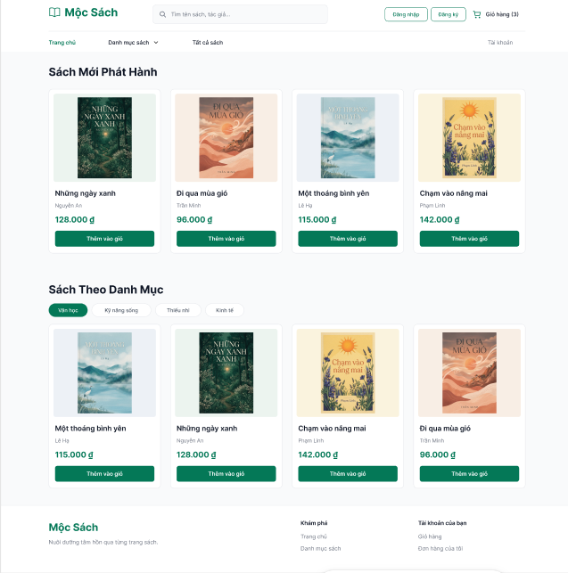

## Chương 3. Công nghệ sử dụng và lý do lựa chọn

### 3.1. Bảng tổng hợp công nghệ sử dụng

| Nhóm chức năng                      | Công nghệ / Công cụ     | Phiên bản / Chuẩn áp dụng | Vai trò trong dự án Mộc Sách                                                                                                                                                      |
| :---------------------------------- | :---------------------- | :------------------------ | :-------------------------------------------------------------------------------------------------------------------------------------------------------------------------------- |
| **Frontend**                        | React (kết hợp Vite)    | React 18+, JSX            | Xây dựng giao diện SPA (Single Page Application) tương tác mượt mà, tái sử dụng component cho cả trang khách hàng và trang quản trị.                                              |
| **Giao diện (UI)**                  | Tailwind CSS            | Tailwind CSS v4           | Thiết kế giao diện nhanh, đồng nhất hệ thống màu sắc thương hiệu Mộc Sách và đáp ứng đa thiết bị (Desktop & Mobile).                                                              |
| **Backend**                         | Laravel Framework       | PHP 8.1+, Laravel 11+     | Xử lý nghiệp vụ máy chủ, định tuyến API, kiểm tra dữ liệu đầu vào, phân quyền quản trị và tương tác cơ sở dữ liệu.                                                                |
| **Cơ sở dữ liệu & Môi trường chạy** | MySQL / MariaDB (XAMPP) | XAMPP (phpMyAdmin)        | Lưu trữ dữ liệu quan hệ (người dùng, danh mục, sách, giỏ hàng, đơn hàng, mã giảm giá, đánh giá sản phẩm), quản trị trực quan qua phpMyAdmin và đảm bảo toàn vẹn giao dịch (ACID). |
| **Giao tiếp dữ liệu**               | RESTful API / JSON      | HTTP/HTTPS, JSON          | Chuẩn hóa trao đổi dữ liệu giữa Frontend (React) và Backend (Laravel) qua các phương thức `GET`, `POST`, `PUT`, `PATCH`, `DELETE`.                                                |
| **Quản lý mã nguồn**                | Git & GitHub            | Git CLI, GitHub Repo      | Quản lý phiên bản, phân chia nhánh tính năng theo từng thành viên (`TV1`–`TV5`), rà soát mã nguồn (Pull Request) và gộp code an toàn.                                             |
| **Quản lý tiến độ**                 | Trello                  | Kanban Board              | Phân rã đầu việc (Task Card `TM-01` đến `TM-09`, `TM-11` đến `TM-14`, `TM-16`), theo dõi tiến độ từng tuần theo mô hình Agile/Scrum mini.                                         |
| **Thiết kế UI/UX**                  | Figma                   | Wireframe & MocKup        | Thiết kế giao diện mẫu cho cả 2 kích thước màn hình Desktop và Mobile trước khi lập trình để thống nhất trải nghiệm toàn nhóm.                                                    |

---

### 3.2. Lý do lựa chọn từng công nghệ

1. **Phù hợp năng lực nhóm và thời gian triển khai 3 tuần:**
   - Các thành viên trong nhóm đã có nền tảng vững về HTML/CSS, JavaScript và PHP/MySQL, do đó việc chọn **React** kết hợp **Laravel** giúp rút ngắn tối đa thời gian làm quen công cụ, tập trung trực tiếp vào xây dựng nghiệp vụ thương mại điện tử (giỏ hàng, đặt hàng, quản lý tồn kho, áp mã giảm giá, viết đáng giá sản phẩm) trong khung thời gian 3 tuần.
   - **Vite** giúp khởi tạo và biên dịch React cực nhanh (Hot Module Replacement), tiết kiệm thời gian kiểm thử giao diện trong quá trình phát triển.

2. **Hệ sinh thái phong phú và tách biệt rõ ràng Frontend – Backend:**
   - Kiến trúc tách rời giao diện (**React**) và máy chủ xử lý (**Laravel REST API**) cho phép các thành viên phụ trách giao diện và thành viên phụ trách API làm việc song song theo hợp đồng dữ liệu JSON đã thống nhất từ đầu, không bị xung đột file giao diện Blade.
   - **Tailwind CSS** cung cấp các lớp tiện ích (utility classes) trực tiếp trong JSX, giúp đồng bộ giao diện Desktop và Mobile nhanh gấp nhiều lần so với viết CSS thuần từng file riêng lẻ.

3. **Cơ chế bảo mật và toàn vẹn dữ liệu có sẵn của Laravel:**
   - **Eloquent ORM & Query Builder:** Sử dụng cơ chế tham số hóa truy vấn (Prepared Statements) mặc định, ngăn chặn triệt để lỗ hổng **SQL Injection**.
   - **Mã hóa mật khẩu (`bcrypt` / `Hash`):** Mật khẩu người dùng được băm một chiều an toàn trước khi lưu vào bảng `users`, tuyệt đối không lưu dạng văn bản thuần (plain text).
   - **Middleware & CSRF Protection:** Sử dụng `AdminAuthMiddleware` để kiểm soát quyền truy cập vào toàn bộ nhóm đường dẫn `/admin` và `/api/admin/*`, ngăn chặn người dùng thường thao tác trái phép; đồng thời tích hợp cơ chế xác thực phiên đăng nhập và bảo vệ chống giả mạo yêu cầu (`CSRF Token`).
   - **Database Transaction (`DB::transaction`) & Khóa bi quan (`lockForUpdate`):** Hỗ trợ xử lý an toàn các nghiệp vụ nhạy cảm như trừ tồn kho khi đặt hàng và hoàn trả tồn kho (`stock`) khi hủy đơn.

4. **Bộ công cụ cộng tác nhóm hiệu quả (Figma – Trello – GitHub):**
   - **Figma** giúp chốt giao diện chuẩn ngay từ tuần 1; **Trello** minh bạch hóa trách nhiệm từng thẻ công việc; **Git/GitHub** lưu vết lịch sử chỉnh sửa và hỗ trợ giải quyết xung đột mã nguồn (merge conflict) khi 5 thành viên cùng đẩy code liên tục.

---

### 3.3. Các thư viện hỗ trợ

| Nhóm thư viện                 | Tên thư viện                                                                 | Mục đích sử dụng trong dự án                                                                                                                                                                             |
| :---------------------------- | :--------------------------------------------------------------------------- | :------------------------------------------------------------------------------------------------------------------------------------------------------------------------------------------------------- |
| **Giao diện & Biểu tượng**    | `tailwindcss`, `lucide-react`                                                | Xây dựng hệ thống lưới responsive, bảng biểu, modal chi tiết đơn hàng và bộ icon vector sắc nét, đồng nhất.                                                                                              |
| **Điều hướng (Routing)**      | `react-router-dom`                                                           | Quản lý điều hướng phía client (SPA) cho các trang công khai (`/`, `/books`, `/cart`, `/checkout`), trang cá nhân (`/profile`, `/orders`) và khu vực quản trị (`/admin/*`).                              |
| **Giao tiếp & Xác thực API**  | `axios`, Fetch API, Laravel `FormRequest`                                    | Gửi các yêu cầu HTTP bất đồng bộ kèm thông tin phiên đăng nhập/CSRF token từ React xuống Laravel; phía Backend sử dụng `FormRequest` và `Validator` để kiểm tra tính hợp lệ của dữ liệu trước khi xử lý. |
| **Xử lý thời gian & Dữ liệu** | `Carbon` (PHP), `Eloquent Collections`                                       | Xử lý định dạng ngày đặt hàng, kiểm tra hạn sử dụng của mã giảm giá (`expired_date`) và biến đổi dữ liệu trả về chuẩn JSON.                                                                              |
| **Kiểm thử & Gỡ lỗi**         | Chrome DevTools, Thunder Client, PHPUnit / Laravel Test (`php artisan test`) | Kiểm thử các endpoint REST API (mã trạng thái `200`, `201`, `401`, `422`), kiểm tra giao diện responsive trên nhiều kích thước màn hình và giả lập dữ liệu nhanh trong CSDL.                             |

---

### 3.4. So sánh ngắn với các phương án đã cân nhắc nhưng không chọn

| Tiêu chí so sánh  | Phương án đã chọn | Phương án cân nhắc (Không chọn)         | Lý do không chọn                                                                                                                                                                                            |
| :---------------- | :---------------- | :-------------------------------------- | :---------------------------------------------------------------------------------------------------------------------------------------------------------------------------------------------------------- |
| **Backend**       | **Laravel (PHP)** | **Node.js (Express) / Django (Python)** | Đa số thành viên thành thạo PHP hơn; Laravel tích hợp sẵn Eloquent, Validation, Migration và Middleware giúp hoàn thiện API trong 3 tuần nhanh hơn việc tự lắp ghép nhiều thư viện rời rạc trên Express.    |
| **Frontend**      | **React (Vite)**  | **Laravel Blade thuần / Vue.js**        | Blade thuần phải tải lại toàn bộ trang mỗi khi lọc sách, đổi tab đơn hàng hay tăng/giảm số lượng giỏ hàng, trải nghiệm kém mượt. Nhóm quen thuộc với React hơn Vue.js.                                      |
| **Styling**       | **Tailwind CSS**  | **Bootstrap 5 / CSS thuần**             | Bootstrap có giao diện mặc định khá cứng, khó tùy biến sâu theo phong cách hiệu sách tối giản (tông xanh ngọc lục bảo – kem) của Mộc Sách; CSS thuần tốn nhiều thời gian đặt tên class và viết media query. |
| **Cơ sở dữ liệu** | **MySQL**         | **MongoDB (NoSQL)**                     | Nghiệp vụ bán sách có tính quan hệ chặt chẽ giữa người dùng, đơn hàng, chi tiết đơn hàng và tồn kho sản phẩm, đòi hỏi ràng buộc khóa ngoại và giao dịch ACID mà MySQL đáp ứng tối ưu nhất.                  |

---

## Chương 5. Thiết kế

## Chương 5. Thiết kế

### 5.2. Cơ sở dữ liệu

#### 5.2.1. Sơ đồ thực thể liên kết (ERD – Bản hoàn chỉnh)

Hệ thống sử dụng cơ sở dữ liệu quan hệ **MySQL / MariaDB (`bookstore_db`)** quản trị trên môi trường **XAMPP (phpMyAdmin)** với **6 bảng cốt lõi** (`users`, `categories`, `products`, `cart_items`, `orders`, `order_items`), đồng thời mở rộng thêm bảng **`voucher`** (mã giảm giá) và mối quan hệ đánh giá **`rating`** giữa người dùng và sản phẩm.

Các mối quan hệ chính trong sơ đồ ERD:

- **`categories` – `products` (`belong to`):** Một danh mục có nhiều sách ($1:N$), mỗi cuốn sách thuộc về một danh mục thông qua `category_id`.
- **`users` – `cart_items` (`of`):** Một người dùng sở hữu nhiều dòng sản phẩm trong giỏ hàng ($1:N$).
- **`products` – `order_items` (`in`) & `orders` – `order_items` (`has`):** Một đơn hàng gồm nhiều chi tiết đơn hàng ($1:N$) và một cuốn sách có thể nằm trong nhiều chi tiết đơn hàng ($1:N$).
- **`users` – `orders` (`of`):** Một khách hàng có thể đặt nhiều đơn hàng ($1:N$).
- **`voucher` – `orders` (`apply`):** Một mã giảm giá có thể được áp dụng cho nhiều đơn hàng ($1:N$, cho phép `NULL` nếu đơn không dùng mã).
- **`users` – `products` (`rating`):** Quan hệ nhiều – nhiều ($N:N$) lưu thông tin đánh giá sao (`star`) và bình luận (`comment`) của người dùng đối với sản phẩm đã mua.

---

#### 5.2.2. Mô tả chi tiết các bảng dữ liệu, khóa chính, khóa ngoại và ràng buộc

Toàn bộ các bảng trong hệ thống đều được thiết kế kèm nhóm trường kiểm soát thời gian và xóa mềm (`created_at`, `updated_at`, `is_delete`, `deleted_at`) nhằm đảm bảo an toàn dữ liệu lịch sử khi quản trị viên thao tác xóa trên giao diện.

1. **Bảng `users` (Người dùng & Quản trị viên)**
   - **Khóa chính (PK):** `user_id` (`BIGINT UNSIGNED, AUTO_INCREMENT`).
   - **Các cột thuộc tính:** `full_name` (`VARCHAR(100)`), `email` (`VARCHAR(150)`), `password` (`VARCHAR(255)`), `phone` (`VARCHAR(20)`), `address` (`TEXT`), `role` (`ENUM('customer', 'admin')`), `status` (`TINYINT` / trạng thái hoạt động), `is_delete` (`TINYINT(1)`), `created_at`, `updated_at`, `deleted_at`.
   - **Ràng buộc:** `email` có ràng buộc `UNIQUE` (duy nhất trên toàn hệ thống, không cho phép đăng ký trùng email); `password` lưu chuỗi mã hóa một chiều `bcrypt`.

2. **Bảng `categories` (Danh mục sách)**
   - **Khóa chính (PK):** `category_id` (`BIGINT UNSIGNED, AUTO_INCREMENT`).
   - **Các cột thuộc tính:** `category_name` (`VARCHAR(100)`), `slug` (`VARCHAR(150)`), `description` (`TEXT, NULL`), `is_delete` (`TINYINT(1)`), `created_at`, `updated_at`, `deleted_at`.
   - **Ràng buộc:** `category_name` và `slug` là `NOT NULL, UNIQUE` để định danh đường dẫn thân thiện SEO và tránh trùng tên thể loại sách.

3. **Bảng `products` (Sản phẩm / Sách)**
   - **Khóa chính (PK):** `product_id` (`BIGINT UNSIGNED, AUTO_INCREMENT`).
   - **Khóa ngoại (FK):** `category_id` tham chiếu tới `categories(category_id)` (`ON DELETE RESTRICT` – ngăn xóa danh mục khi vẫn còn sách thuộc danh mục đó).
   - **Các cột thuộc tính:** `product_name` (`VARCHAR(255)`), `slug` (`VARCHAR(255)`), `author` (`VARCHAR(150)`), `publisher_name` (`VARCHAR(150)`), `price` (`DECIMAL(12,0)`), `stock` (`INT UNSIGNED`), `image` (`VARCHAR(255)`), `description` (`TEXT`), `status` (`TINYINT` / hiển thị hoặc ẩn), `is_delete` (`TINYINT(1)`), `created_at`, `updated_at`, `deleted_at`.
   - **Ràng buộc:** `price >= 0` và `stock >= 0` (kiểu số nguyên không dấu `UNSIGNED` kết hợp kiểm tra ở tầng ứng dụng đảm bảo số lượng tồn kho không bao giờ âm).

4. **Bảng `cart_items` (Chi tiết giỏ hàng)**
   - **Khóa chính (PK):** `cart_id` (`BIGINT UNSIGNED, AUTO_INCREMENT`).
   - **Khóa ngoại (FK):**
     - `user_id` tham chiếu tới `users(user_id)` (`ON DELETE CASCADE`).
     - `product_id` tham chiếu tới `products(product_id)` (`ON DELETE CASCADE`).
   - **Các cột thuộc tính:** `quantity` (`INT UNSIGNED`), `is_delete` (`TINYINT(1)`), `created_at`, `updated_at`, `deleted_at`.
   - **Ràng buộc:** `quantity >= 1`; mỗi cặp `(user_id, product_id)` chưa xóa mềm là duy nhất để khi khách thêm trùng sách đã có trong giỏ thì hệ thống cộng dồn số lượng.

5. **Bảng `orders` (Đơn hàng)**
   - **Khóa chính (PK):** `order_id` (`BIGINT UNSIGNED, AUTO_INCREMENT`).
   - **Khóa ngoại (FK):**
     - `user_id` tham chiếu tới `users(user_id)` (`ON DELETE RESTRICT`).
     - `voucher_id` (`NULLABLE`) tham chiếu tới `voucher(voucher_id)` (`ON DELETE SET NULL`).
   - **Các cột thuộc tính:** `recipient_name` (`VARCHAR(100)`), `recipient_phone` (`VARCHAR(20)`), `shipping_address` (`TEXT`), `order_date` (`DATETIME`), `total_amount` (`DECIMAL(12,0)`), `status` (`ENUM('pending', 'processing', 'shipping', 'completed', 'cancelled')`), `is_delete` (`TINYINT(1)`), `created_at`, `updated_at`, `deleted_at`.
   - **Ràng buộc:** `total_amount >= 0`; `status` chỉ nhận một trong 5 trạng thái hợp lệ của quy trình xử lý đơn hàng.

6. **Bảng `order_items` (Chi tiết đơn hàng)**
   - **Khóa chính (PK):** `order_item_id` (`BIGINT UNSIGNED, AUTO_INCREMENT`).
   - **Khóa ngoại (FK):**
     - `order_id` tham chiếu tới `orders(order_id)` (`ON DELETE CASCADE`).
     - `product_id` tham chiếu tới `products(product_id)` (`ON DELETE RESTRICT`).
   - **Các cột thuộc tính:** `quantity` (`INT UNSIGNED`), `unit_price` (`DECIMAL(12,0)`), `subtotal` (`DECIMAL(12,0)`), `is_delete` (`TINYINT(1)`), `created_at`, `updated_at`, `deleted_at`.
   - **Ràng buộc:** `quantity >= 1`, `unit_price >= 0`, `subtotal = quantity * unit_price`.

7. **Bảng `voucher` (Mã giảm giá – Bảng mở rộng)**
   - **Khóa chính (PK):** `voucher_id` (`BIGINT UNSIGNED, AUTO_INCREMENT`).
   - **Các cột thuộc tính:** `code` (`VARCHAR(50)`), `discount_amount` (`DECIMAL(12,0)`), `expired_date` (`DATE`), `description` (`TEXT, NULL`), `is_delete` (`TINYINT(1)`), `created_at`, `updated_at`, `deleted_at`.
   - **Ràng buộc:** `code` có ràng buộc `UNIQUE` và tự động chuẩn hóa chữ in hoa (`NOT NULL`); `discount_amount >= 1000`; `expired_date` bắt buộc hợp lệ để hệ thống đối chiếu thời hạn sử dụng khi khách áp mã tại giỏ hàng.

8. **Bảng `rating` (Đánh giá sản phẩm – Bảng mở rộng)**
   - **Khóa chính kết hợp (Composite PK):** `(user_id, product_id)`.
   - **Khóa ngoại (FK):**
     - `user_id` tham chiếu tới `users(user_id)` (`ON DELETE CASCADE`).
     - `product_id` tham chiếu tới `products(product_id)` (`ON DELETE CASCADE`).
   - **Các cột thuộc tính:** `star` (`TINYINT UNSIGNED` – số sao đánh giá từ 1 đến 5), `comment` (`TEXT, NULL` – nội dung nhận xét của khách hàng).
   - **Ràng buộc:** `star BETWEEN 1 AND 5`; mỗi cặp `(user_id, product_id)` là duy nhất để đảm bảo mỗi tài khoản chỉ đánh giá một lần cho một đầu sách đã mua thành công.

---

#### 5.2.3. Chuẩn hóa dữ liệu (3NF) và lý do thiết kế nghiệp vụ

1. **Đảm bảo chuẩn hóa 3NF (Third Normal Form):**
   - **Đạt chuẩn 1NF:** Tất cả các thuộc tính trong từng bảng đều mang giá trị nguyên tử (đơn trị), không lưu danh sách nhiều mã sách hay nhiều số lượng trong cùng một cột; mỗi bảng đều có khóa chính định danh duy nhất (`user_id`, `category_id`, `product_id`, `cart_id`, `order_id`, `order_item_id`).
   - **Đạt chuẩn 2NF:** Các thuộc tính không khóa trong mọi bảng đều phụ thuộc hàm đầy đủ vào toàn bộ khóa chính. Ví dụ ở bảng `order_items`, các cột `quantity`, `unit_price`, `subtotal` phụ thuộc vào chi tiết từng dòng sản phẩm của một đơn hàng cụ thể (`order_item_id`), không phụ thuộc bộ phận.
   - **Đạt chuẩn 3NF:** Loại bỏ hoàn toàn sự phụ thuộc bắc cầu giữa các thuộc tính không khóa:
     - Bảng `products` chỉ lưu khóa ngoại `category_id` để tham chiếu sang `categories`, không lưu lặp lại `category_name` hay `description` của danh mục.
     - Bảng `orders` lưu `user_id` và `voucher_id` thay vì lưu lặp lại thông tin hồ sơ tài khoản `users` hay thông tin `code`, `discount_amount` của `voucher`. Các cột `recipient_name`, `recipient_phone`, `shipping_address` trên `orders` là thông tin giao nhận riêng của từng đơn hàng (khách có thể đặt tặng người khác hoặc giao tới địa chỉ khác địa chỉ mặc định trong `users`).

2. **Vì sao phải tách riêng bảng `order_items` khỏi `orders`?**
   - Một đơn hàng (`orders`) có thể chứa nhiều đầu sách khác nhau với số lượng khác nhau, và một đầu sách (`products`) có thể xuất hiện trong nhiều đơn hàng của nhiều khách hàng — đây là mối quan hệ **nhiều – nhiều ($N:N$)**.
   - Trong mô hình cơ sở dữ liệu quan hệ, không thể lưu trực tiếp quan hệ $N:N$ trên 2 bảng mà không gây dư thừa dữ liệu hoặc vi phạm chuẩn 1NF. Việc tách bảng trung gian **`order_items`** chuyển quan hệ $N:N$ thành hai quan hệ $1:N$ (`orders` $1 - N$ `order_items` và `products` $1 - N$ `order_items`), giúp truy vấn chi tiết hóa đơn, thống kê doanh thu theo từng đầu sách và hoàn trả tồn kho (`stock`) khi hủy đơn chính xác tuyệt đối.

3. **Vì sao phải lưu `unit_price` (giá tại thời điểm mua) trong `order_items`?**
   - Giá bán `price` của sách trong bảng `products` có thể được quản trị viên điều chỉnh tăng/giảm theo từng đợt nhập hàng hoặc chương trình khuyến mãi.
   - Nếu `order_items` không lưu lại `unit_price` mà tính tiền đơn hàng dựa trên `products.price` hiện tại, thì mỗi khi Admin cập nhật giá sách mới, **toàn bộ lịch sử hóa đơn và doanh thu của các đơn hàng đã đặt trước đó sẽ bị sai lệch**. Lưu cứng `unit_price` tại thời điểm đặt hàng giúp cố định giá trị giao dịch lịch sử và đảm bảo tính chính xác của báo cáo tài chính.

---

#### 5.2.4. Chiến lược đánh chỉ mục (Indexing) tối ưu truy vấn

Hệ thống sử dụng **Storage Engine InnoDB** trên XAMPP và thiết lập các chỉ mục (Index) trên những cột thường xuyên dùng trong điều kiện lọc (`WHERE`), kết nối bảng (`JOIN`) và sắp xếp (`ORDER BY`):

| Tên chỉ mục (Index)        | Bảng & Cột áp dụng                       | Loại Index                        | Mục đích & Tác dụng tối ưu                                                                                                                                                                                                                                          |
| :------------------------- | :--------------------------------------- | :-------------------------------- | :------------------------------------------------------------------------------------------------------------------------------------------------------------------------------------------------------------------------------------------------------------------ |
| `idx_products_name`        | `products(product_name)` _(hoặc `name`)_ | B-Tree Index                      | Tăng tốc độ tìm kiếm sách theo từ khóa trên thanh tìm kiếm trang chủ và trang danh sách sản phẩm (`LIKE 'keyword%'` / sắp xếp theo tên sách)                                                                                                                        |
| `idx_products_category_id` | `products(category_id)`                  | Foreign Key Index                 | Tối ưu hiệu năng khi người dùng lọc sách theo từng danh mục thể loại và khi thực hiện phép nối (`JOIN`) giữa bảng `products` và `categories`                                                                                                                        |
| `idx_orders_user_status`   | `orders(user_id, status)`                | Composite Index (Chỉ mục kết hợp) | Tối ưu đồng thời 2 truy vấn phổ biến nhất: lấy danh sách đơn hàng của một khách hàng (`WHERE user_id = ?`) và lọc đơn hàng theo tab trạng thái (`WHERE user_id = ? AND status = ?`) trên trang _Đơn hàng của tôi_ cũng như thống kê trạng thái phía Admin[cite: 7]. |
