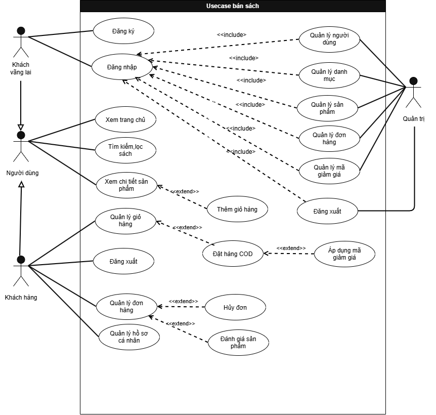

# CHƯƠNG 4. PHÂN TÍCH YÊU CẦU

## 4.1 Danh sách user story

Product Backlog được viết dưới dạng user story kèm tiêu chí chấp nhận và mức ưu tiên (Must: bắt buộc; Could: cộng điểm).

### Phân hệ Khách vãng lai

| Mã    | User story                                                                                           | Tiêu chí chấp nhận chính                                                                                         | Mức  |
| ----- | ---------------------------------------------------------------------------------------------------- | ---------------------------------------------------------------------------------------------------------------- | ---- |
| TM-01 | Là khách vãng lai, tôi muốn xem sách mới và sách theo danh mục ở trang chủ để nhanh chóng chọn sách. | 8 sách mới nhất và khối sách theo danh mục lấy từ CSDL; menu danh mục động; sách ẩn không hiển thị               | Must |
| TM-02 | Là khách vãng lai, tôi muốn tìm và lọc sách để nhanh chóng tìm đúng cuốn cần mua.                    | Tìm theo tên; lọc theo danh mục, khoảng giá; sắp xếp theo giá/mới nhất; phân trang phía server                   | Must |
| TM-03 | Là khách vãng lai, tôi muốn xem chi tiết một cuốn sách để quyết định có mua hay không.               | Hiển thị ảnh, giá, mô tả, tồn kho; nút "Thêm vào giỏ" yêu cầu đăng nhập                                          | Must |
| TM-04 | Là khách vãng lai, tôi muốn đăng ký và đăng nhập để mua hàng và theo dõi đơn.                        | Email duy nhất, mật khẩu từ 8 ký tự và được băm; điều hướng theo vai trò; tài khoản bị khóa không đăng nhập được | Must |

### Phân hệ Khách hàng

| Mã    | User story                                                                 | Tiêu chí chấp nhận chính                                                                           | Mức   |
| ----- | -------------------------------------------------------------------------- | -------------------------------------------------------------------------------------------------- | ----- |
| TM-05 | Là khách hàng, tôi muốn thêm sách vào giỏ để mua nhiều cuốn trong một đơn. | Thêm, sửa số lượng, xóa; không vượt tồn kho; tính tổng tiền; lưu trong CSDL                        | Must  |
| TM-06 | Là khách hàng, tôi muốn đặt hàng và thanh toán khi nhận hàng.              | Nhập tên, SĐT, địa chỉ; tạo đơn "Chờ xác nhận", trừ tồn kho và xóa giỏ trong một transaction       | Must  |
| TM-07 | Là khách hàng, tôi muốn xem và theo dõi các đơn đã đặt.                    | Danh sách, chi tiết đơn; hủy được khi còn "Chờ xác nhận" (hoàn tồn kho); chỉ xem được đơn của mình | Must  |
| TM-08 | Là khách hàng, tôi muốn sửa thông tin cá nhân và đổi mật khẩu.             | Sửa họ tên, SĐT, địa chỉ; đổi mật khẩu phải nhập mật khẩu cũ                                       | Must  |
| TM-09 | Là khách hàng, tôi muốn đánh giá sách đã mua để chia sẻ trải nghiệm.       | 1–5 sao kèm bình luận; chỉ cho sản phẩm trong đơn "Hoàn thành"                                     | Could |

### Phân hệ Quản trị

| Mã    | User story                                                                     | Tiêu chí chấp nhận chính                                          | Mức   |
| ----- | ------------------------------------------------------------------------------ | ----------------------------------------------------------------- | ----- |
| TM-11 | Là quản trị viên, tôi muốn quản lý danh mục sách để tổ chức cửa hàng gọn gàng. | CRUD; tên không trùng; không xóa danh mục đang có sản phẩm        | Must  |
| TM-12 | Là quản trị viên, tôi muốn quản lý sách để cập nhật cửa hàng kịp thời.         | CRUD; tải 1 ảnh (jpg/png ≤ 2 MB); ẩn/hiện; tìm kiếm và phân trang | Must  |
| TM-13 | Là quản trị viên, tôi muốn xử lý đơn hàng từ lúc đặt đến lúc giao.             | Lọc theo trạng thái; chuyển trạng thái một chiều, không đi ngược  | Must  |
| TM-14 | Là quản trị viên, tôi muốn xem người dùng và khóa/mở khóa tài khoản.           | Danh sách, tìm theo email; tài khoản khóa không đăng nhập được    | Must  |
| TM-16 | Là quản trị viên, tôi muốn tạo mã giảm giá để khuyến mãi cho khách.            | CRUD mã (% hoặc số tiền, có hạn dùng); áp dụng khi đặt hàng       | Could |

## 4.2 Use case diagram

Hình 4.1 là sơ đồ use case của hệ thống bán sách.

_Hình 4.1. Use case diagram của hệ thống bán sách._

### Tác nhân

Sơ đồ có bốn tác nhân:

- **Người dùng:** tác nhân tổng quát (trừu tượng), đại diện cho những chức năng ai cũng dùng được: xem trang chủ, tìm kiếm, lọc sách và xem chi tiết sản phẩm.
- **Khách vãng lai:** người chưa đăng nhập; kế thừa Người dùng và có thêm Đăng ký, Đăng nhập.
- **Khách hàng:** người đã đăng nhập; kế thừa Người dùng và có thêm quản lý giỏ hàng, đơn hàng, hồ sơ cá nhân và đăng xuất.
- **Quản trị:** chủ cửa hàng, tác nhân độc lập, quản lý người dùng, danh mục, sản phẩm, đơn hàng và mã giảm giá.
  Nhóm tạo tác nhân trung gian Người dùng thay vì cho Khách hàng kế thừa trực tiếp Khách vãng lai. Nếu kế thừa trực tiếp thì Khách hàng sẽ thừa cả Đăng ký và Đăng nhập, trong khi khách hàng đã đăng nhập thì không cần hai chức năng này. Với cách thiết kế hiện tại, Khách vãng lai và Khách hàng cùng chia sẻ các chức năng xem sách nhưng không lẫn chức năng của nhau.

### Use case theo tác nhân

| Tác nhân                | Use case                       | Mã chức năng |
| ----------------------- | ------------------------------ | ------------ |
| Người dùng (dùng chung) | Xem trang chủ                  | TM-01        |
|                         | Tìm kiếm, lọc sách             | TM-02        |
|                         | Xem chi tiết sản phẩm          | TM-03        |
| Khách vãng lai          | Đăng ký, Đăng nhập             | TM-04        |
| Khách hàng              | Quản lý giỏ hàng               | TM-05        |
|                         | Quản lý đơn hàng (đơn của tôi) | TM-07        |
|                         | Quản lý hồ sơ cá nhân          | TM-08        |
|                         | Đăng xuất                      | TM-04        |
| Quản trị                | Quản lý danh mục               | TM-11        |
|                         | Quản lý sản phẩm               | TM-12        |
|                         | Quản lý đơn hàng               | TM-13        |
|                         | Quản lý người dùng             | TM-14        |
|                         | Quản lý mã giảm giá            | TM-16        |
|                         | Đăng xuất                      | TM-04        |

### Quan hệ include và extend

| Quan hệ | Use case phụ        | Use case chính                                                                          | Điều kiện / ý nghĩa                                                    |
| ------- | ------------------- | --------------------------------------------------------------------------------------- | ---------------------------------------------------------------------- |
| include | Đăng nhập           | Quản lý người dùng, danh mục, sản phẩm, đơn hàng, mã giảm giá, Đăng xuất (của Quản trị) | Quản trị luôn phải đăng nhập trước khi dùng các chức năng này          |
| extend  | Thêm giỏ hàng       | Xem chi tiết sản phẩm                                                                   | Khi người xem đã đăng nhập là khách hàng và bấm "Thêm vào giỏ" (TM-05) |
| extend  | Đặt hàng COD        | Quản lý giỏ hàng                                                                        | Khi giỏ có sản phẩm và khách chọn "Đặt hàng" (TM-06)                   |
| extend  | Áp dụng mã giảm giá | Đặt hàng COD                                                                            | Khi khách nhập mã giảm giá lúc đặt hàng (TM-16)                        |
| extend  | Hủy đơn             | Quản lý đơn hàng                                                                        | Khi đơn còn ở trạng thái "Chờ xác nhận" (TM-07)                        |
| extend  | Đánh giá sản phẩm   | Quản lý đơn hàng                                                                        | Khi đơn đã "Hoàn thành" (TM-09)                                        |

## 4.3 Đặc tả use case chính

### UC-01: Đăng nhập

#### Tác nhân: Khách vãng lai (đã có tài khoản), khách hàng, quản trị

Mô tả: Xác thực bằng email và mật khẩu để truy cập vào hệ thống. Hệ thống dùng session và cookie của Laravel. Điều hướng theo vai trò:admin về trang quản trị, vai trò còn lại về trang chủ.

#### Tiền điều kiện:

- Người dùng đã có tài khoản
- Chưa đăng nhập (chưa có phiên )

#### Hậu điều kiện:

- Thành công: hệ thống tạo phiên (cookie session, HttpOnly) và trả về thông tin người dùng; giao diện lưu thông tin hiển thị và điều hướng theo vai trò.
- Thất bại: không tạo phiên, giao diện hiển thị thông báo lỗi.

#### Luồng chính:

1. Người dùng mở trang Đăng nhập.
2. Hệ thống trả khung trang, cấp XSRF-TOKEN để chống csrf.
3. Người dùng nhập email,mật khẩu, bấm "Đăng nhập";giao diện gửi yêu cầu JSON kèm mã CSRF TOKEN trong header X-XSRF-TOKEN.
4. Hệ thống kiểm tra mã CSRF.
5. Hệ thống kiểm tra dữ liệu:email,mật khẩu.(đúng định dạng,không rỗng).
6. Hệ thống tìm tài khoản theo email và so khớp mật khẩu với mã băm.
7. Hệ thống kiểm tra tài khoản không bị khóa,chỉ kiểm tra sau khi mật khẩu đúng.
8. Hệ thống đăng nhập tài khoản,tạo phiên,tạo mã phiên.
9. Hệ thống trả về thông tin người dùng(id,name,email,role);điều hướng theo vai trò.('/admin' vai trò admin, ngược lại '/')
10. Giao diện lưu thông tin người dùng (chỉ để hiển thị)

#### Luồng phụ:

- A1. Chưa có tài khoản: người dùng chọn "Đăng ký" chuyển sang trang Đăng ký.
- A2. Đã đăng nhập mà mở lại trang Đăng nhập:giao diện chuyển đến theo vai trò.
- A3. Đăng xuất:Hủy phiên,tạo lại mã CSRF.

#### Luồng ngoại lệ:

- E1. Bỏ trống hoặc sai định dạng (bước 5),hệ thống trả về HTTP 422 kèm theo lỗi từng trường.
- E2. Email không tồn tại hoặc sai mật khẩu (bước 6):HTTP 401 ,thông báo chung"Email hoặc mật khẩu không tồn tại".
- E3. Tài khoản bị khóa (bước 7), hệ thống trả về HTTP 401,thông báo"Tài khoản đã bị khóa vui lòng liên hệ quản trị viên".
- E4. Mã CSRF thiếu hoặc hết hạn(bước 4):HTTP 419;người dùng tải lại trang và thử lại.
- E5. Lỗi máy chủ or CSDL:HTTP 500,Laravel tự động ghi log, không tạo phiên.

### UC-02: Quản lý sản phẩm

#### Tác nhân: Quản trị

#### Mô tả: Thêm, xem, sửa, xóa, ẩn/hiện sách; tìm kiếm và phân trang phía server.

#### Tiền điều kiện:

- Đã đăng nhập với vai trò admin
- Có ít nhất 1 danh mục

#### Hậu điều kiện

- Thành công: dữ liệu sản phẩm được cập nhật trong CSDL, thay đổi hiển thị ngay ở trang khách hàng.
- Thất bại: không có thay đổi nào trong CSDL.

#### Luồng chính (Thêm sản phẩm)

1. Quản trị mở trang "Quản lý sản phẩm".
2. Hệ thống kiểm tra quyền admin và hiển thị danh sách phân trang phía server (10 đến 20 sách mỗi trang, không hiển thị sách đã xóa mềm)
3. Quản trị bấm "Thêm sản phẩm"
4. Hệ thống hiển thị form: tên, danh mục (chọn từ danh sách hiện có), giá, tồn kho, mô tả, ảnh đại diện, ẩn/hiện, kèm CSRF Token
5. Quản trị nhập thông tin, chọn 1 ảnh (jpg/png tối đa 2MB) và bấm "Lưu"
6. Hệ thống kiểm tra phía server: CSRF token; tên không rỗng; giá lớn hơn 0; tồn kho là số nguyên không âm; danh mục tồn tại; ảnh đúng định dạng và dung lượng, kiểm tra theo nội dung tệp chứ không chỉ theo đuôi tên tệp.
7. Hệ thống lưu ảnh vào thư mục lưu trữ với tên ngẫu nhiên (không dùng tên gốc của tệp), rồi lưu thông tin sản phẩm vào CSDL.
8. Hệ thống thông báo thêm thành công và cập nhật lại danh sách.

#### Luồng phụ:

- A1. Tìm kiếm: nhập từ khóa, danh sách lọc theo tên, vẫn phân trang phía server. Từ khóa đi qua tham số của truy vấn (chống SQL Injection).
- A2. Sửa sản phẩm: chọn “Sửa”, form điền sẵn dữ liệu, chỉnh sửa rồi “Lưu”, kiểm tra như bước 6. Không chọn ảnh mới thì giữ ảnh cũ; có ảnh mới thì thay và xóa ảnh cũ sau khi lưu thành công. Giá mới không ảnh hưởng order_items cũ.
- A3. Ẩn/hiện: bật hoặc tắt trạng thái. Sản phẩm ẩn không hiển thị ở trang khách và không đặt hàng được, nhưng vẫn còn trong CSDL.
- A4. Xóa sản phẩm chưa có đơn: hiển thị hộp xác nhận, đồng ý thì xóa sản phẩm, gỡ khỏi các giỏ hàng đang chứa nó và xóa tệp ảnh trong cùng một thao tác.
- A5. Xóa sản phẩm đã có trong đơn: xóa mềm (is_deleted = 1), không xóa cứng. Các đơn cũ vẫn xem được sản phẩm đã mua.
- A6. Xem chi tiết một sản phẩm từ danh sách.

#### Luồng ngoại lệ:

- E1. Dữ liệu không hợp lệ (bước 6): báo lỗi ngay tại trường sai, giữ lại dữ liệu đã nhập (riêng tệp ảnh phải chọn lại).
- E2. Ảnh sai định dạng, lớn hơn 2 MB hoặc nội dung không phải ảnh thật: báo lỗi, không lưu sản phẩm.
- E3. Người không phải admin gọi URL hoặc API quản trị: từ chối 403 (kiểm tra quyền ở server). Chưa đăng nhập: 401 và chuyển đến trang đăng nhập.
- E4. Phiên hết hạn khi đang nhập form: chuyển đến đăng nhập, báo dữ liệu chưa được lưu.
- E5. Danh mục bị xóa hoặc ẩn trong lúc đang nhập: báo “Danh mục không tồn tại”, giữ dữ liệu, cho chọn lại danh mục.
- E6. Hai quản trị cùng sửa một sản phẩm: dùng phiên bản (version hoặc updated_at) để phát hiện. Người lưu sau nhận thông báo “Sản phẩm đã được cập nhật bởi người khác, vui lòng tải lại”, tránh ghi đè mất dữ liệu.
- E7. Sửa hoặc xóa sản phẩm không còn tồn tại (đã bị admin khác xóa): báo “Sản phẩm không tồn tại”, làm mới danh sách.
- E8. Lỗi lưu ảnh (đầy ổ đĩa, không có quyền ghi): báo lỗi, không tạo sản phẩm.
- E9. Lỗi CSDL sau khi đã lưu ảnh: hoàn tác, xóa ảnh vừa lưu, báo lỗi, ghi log.
- E10. CSRF token sai hoặc hết hạn: từ chối, tải lại form, giữ dữ liệu nhập.

### UC-03: Đặt hàng COD

## 4.4 Yêu cầu phi chức năng

| Mã      | Nhóm      | Yêu cầu                                                                                                       |
| ------- | --------- | ------------------------------------------------------------------------------------------------------------- |
| NFR-01  | Bảo mật   | Mật khẩu được băm; chống SQL Injection, XSS, CSRF; kiểm tra quyền phía server cho mọi chức năng quản trị      |
| NFR-02  | Bảo mật   | Không đưa mật khẩu, chuỗi kết nối, khóa API vào repository (dùng `.env` và `.gitignore`)                      |
| NFR-03  | Hiệu năng | Danh sách phân trang phía server; thời gian phản hồi dưới 2 giây với dữ liệu mẫu                              |
| NFR-04  | Giao diện | Responsive trên màn hình 360 px và 1366 px; thông báo lỗi tiếng Việt, chỉ rõ trường sai                       |
| NFR-05  | Dữ liệu   | Kiểm tra dữ liệu phía server; dữ liệu đã phát sinh giao dịch không xóa cứng                                   |
| NFR-06  | Bảo trì   | Kiến trúc 3 lớp; README cài đặt chạy được trên máy sạch trong 15 phút; tối thiểu 5 unit test cho tầng Service |
| TM-NFR1 | Toàn vẹn  | Đặt hàng trong transaction; hai khách cùng mua sách còn 1 cuốn thì chỉ một đơn thành công, tồn kho không âm   |
| TM-NFR2 | Toàn vẹn  | Giá trong `order_items` không đổi khi quản trị sửa giá sản phẩm sau đó                                        |
| TM-NFR3 | Hiển thị  | Tiền định dạng `120.000 ₫`; lưu kiểu số nguyên hoặc decimal, không dùng float                                 |
| TM-NFR4 | Bảo mật   | Khách hàng chỉ xem được đơn của chính mình (đổi ID trên URL phải bị chặn)                                     |
