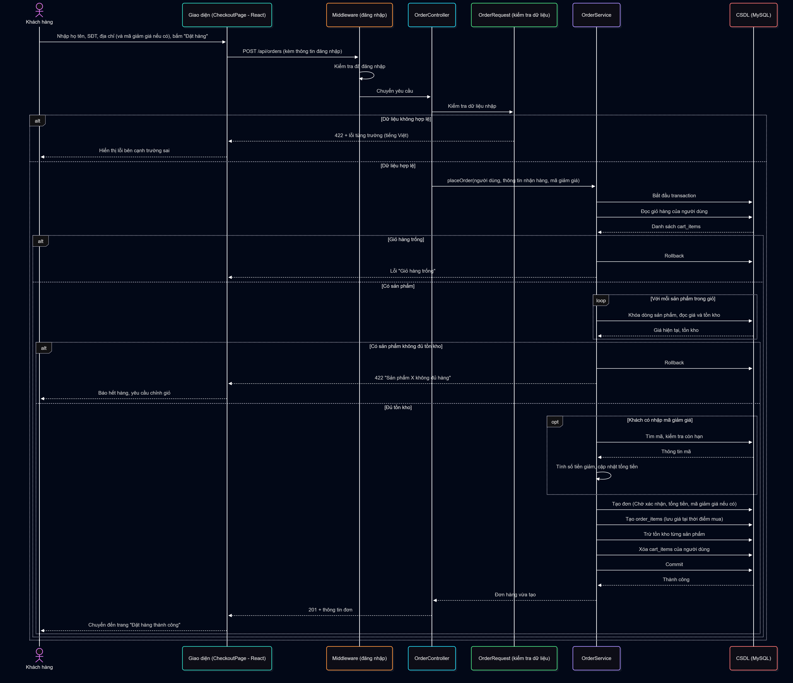

## 5.3 Sequence diagram: luồng Đặt hàng COD

Luồng **Đặt hàng** (TM-06) là luồng nghiệp vụ phức tạp nhất của hệ thống vì đi qua đủ các lớp và phải đảm bảo toàn vẹn dữ liệu: nhiều bảng cùng thay đổi (đơn hàng, dòng đơn, tồn kho, giỏ hàng) và phải thành công hoặc thất bại cùng nhau. Theo use case diagram (mục 4.2), Đặt hàng COD mở rộng từ Quản lý giỏ hàng và có điểm mở rộng Áp dụng mã giảm giá (TM-16). Sơ đồ dưới đây mô tả luồng từ lúc khách hàng bấm "Đặt hàng" đến khi nhận kết quả.

_Hình 5.3. Sequence diagram luồng Đặt hàng COD._

### Giải thích sơ đồ

| Giai đoạn           | Mô tả                                                                                                                                                                                                                |
| ------------------- | -------------------------------------------------------------------------------------------------------------------------------------------------------------------------------------------------------------------- |
| Gửi yêu cầu         | Khách hàng nhập thông tin nhận hàng (và mã giảm giá nếu có) trên trang đặt hàng; giao diện gửi `POST /api/orders` kèm thông tin đăng nhập.                                                                           |
| Xác thực            | Middleware chặn người chưa đăng nhập; yêu cầu hợp lệ được chuyển đến Controller.                                                                                                                                     |
| Kiểm tra dữ liệu    | `OrderRequest` kiểm tra dữ liệu phía server (họ tên, số điện thoại, địa chỉ). Sai thì trả lỗi 422 kèm thông báo từng trường, không đi tiếp.                                                                          |
| Mở transaction      | Controller chỉ điều phối, giao nghiệp vụ cho `OrderService.placeOrder()`. Service mở **một transaction** duy nhất cho toàn bộ luồng rồi đọc giỏ hàng. Giỏ trống thì rollback và báo lỗi.                             |
| Kiểm tra tồn kho    | Với mỗi sản phẩm, Service khóa dòng sản phẩm rồi đọc giá và tồn kho, nên hai khách mua cùng lúc sẽ được xử lý lần lượt (đáp ứng TM-NFR1). Nếu có sản phẩm không đủ hàng thì rollback toàn bộ, không tạo đơn dở dang. |
| Áp dụng mã giảm giá | Nhánh tùy chọn: nếu khách nhập mã, Service kiểm tra mã còn hạn và tính lại tổng tiền.                                                                                                                                |
| Ghi dữ liệu         | Tạo đơn ở trạng thái "Chờ xác nhận", tạo các dòng đơn với **giá tại thời điểm mua** (TM-NFR2), trừ tồn kho, xóa giỏ rồi commit.                                                                                      |
| Trả kết quả         | Kết quả trả về qua Controller dưới dạng JSON; giao diện chuyển sang trang "Đặt hàng thành công".                                                                                                                     |

### Các điểm thiết kế đáng chú ý

- **Transaction:** các thao tác ghi (tạo đơn, tạo dòng đơn, trừ tồn kho, xóa giỏ) hoặc cùng thành công, hoặc cùng bị hủy, nên không xảy ra tình trạng đơn đã tạo mà tồn kho chưa trừ.
- **Chống bán vượt tồn kho:** khóa dòng sản phẩm (hoặc điều kiện cập nhật `stock >= số lượng`) bảo đảm tồn kho không âm khi có nhiều phiên đặt cùng lúc.
- **Tách lớp:** Controller nhận yêu cầu, `OrderRequest` kiểm tra dữ liệu, `OrderService` giữ nghiệp vụ và transaction, lớp truy cập dữ liệu làm việc với CSDL; không có truy vấn CSDL trong giao diện.
- **Lưu giá lúc mua:** giá nằm trong `order_items`, nên việc quản trị đổi giá sản phẩm sau đó không làm thay đổi đơn cũ.
