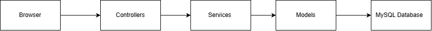

### Chương 5. Thiết kế

**5.1 Kiến trúc**
- Sơ đồ kiến trúc tổng thể


- Thành phần của hệ thống:
  - Browser: Nơi người dùng thao tác trên giao diện React, gửi request và nhận dữ liệu phản hồi để cập nhật giao diện.
  - Routing: Tiếp nhận request, chuyển tiếp request vào chuỗi xử lý của Laravel.
  - Middleware: Kiểm soát các điều kiện trước/sau khi vào controller như xác thực, phân quyền vai trò.
  - Requests: Lớp Request chuyên trách kiểm tra và chuẩn hóa dữ liệu đầu vào trước khi đến Controller.
  - Controller: Điều phối request, nhận dữ liệu đã qua kiểm duyệt, gọi Services và trả về kết quả phản hồi.
  - Services: Chứa logic nghiệp vụ chính của ứng dụng.
  - Models: Lớp Eloquent ORM đại diện cho các bảng dữ liệu, khai báo quan hệ của các bảng dữ liệu.
  - Database: Cơ sở dữ liệu lưu trữ toàn bộ dữ liệu của hệ thống.

- Kiến trúc backend 3 lớp: Controller – Service – Repository/Model
  1. Controller:
      - Đóng vai trò cầu nối giữa Request và tầng nghiệp vụ.
      - Không chứa logic nghiệp vụ phức tạp, chỉ trích xuất dữ liệu đầu vào hợp lệ, gọi phương thức ở Service và định dạng phản hồi trả về.
  3.  Service:
      - Nơi tập trung toàn bộ quy tắc nghiệp vụ.
      - Giúp logic nghiệp vụ độc lập với Controller, dễ tái sử dụng và tránh viễck Controller bị phình to.
  4. Model:
      - Ánh xạ thực thể với bảng trong Database thông qua ORM, định nghĩa các thuộc tính có thể gán, kiểu dữ liệu và mối quan hệ giữa các bảng.
 
- Luồng một request đi qua các lớp
  - Khi người dùng thực hiện đặt hàng, một request đi qua các khối trong sơ đồ theo thứ tự sau:
    1. Trình duyệt: Người dùng nhấn đặt hàng trên giao diện React; trình duyệt gửi request đặt hàng (kèm thông tin sản phẩm/giỏ hàng, địa chỉ giao nhận, phương thức thanh toán và thông tin xác thực) tới server.
    2. Routing: Bộ định tuyến nhận request, khớp với route đặt hàng và chuyển tiếp tới Middleware.
    3. Middleware: Kiểm tra trạng thái đăng nhập, quyền hạn của người dùng.
    4. Requests: Form Request kiểm tra tính hợp lệ của các trường dữ liệu gửi lên, nếu không đạt sẽ trả về lỗi xác thực ngay.
    5. Controller: Nhận dữ liệu đã được Requests xác thực và gọi phương thức xử lý tạo đơn hàng bên Services.
    6. Services: Thực hiện nghiệp vụ đặt hàng thông qua Models.
    7. Models và Database: Models thực thi các câu lệnh xuống Database, sau đó trả kết quả ngược lên Services → Controller → Browser để React hiển thị trạng thái đặt hàng thành công hoặc thông báo lỗi tương ứng.
- Cấu trúc thư mục có chú thích vai trò từng thư mục:
```bash
└── ngoctramcam-ecommerce-project/
    ├── app/
    │   ├── Http/
    │   │   ├── Controllers/            # Lớp tiếp nhận request, gọi Service, trả phản hồi
    │   │   ├── Middleware/             # Lớp Xác thực, phân quyền
    │   │   └── Requests/               # Lớp Kiểm tra và chuẩn hóa dữ liệu đầu vào
    │   ├── Models/                     # Lớp ánh xạ bảng CSDL, khai báo quan hệ
    │   └── Services/                   # Lớp Xử lý nghiệp vụ chính và điều phối thao tác dữ liệu
    ├── bootstrap/                      # Khởi tạo các file cache khởi động
    ├── config/                         # Chứa các file cấu hình hệ thống (CSDL, xác thực, dịch vụ...)
    ├── database/               
    │   ├── factories/                  # Tạo dữ liệu mẫu phục vụ kiểm thử và seeding
    │   ├── migrations/                 # Lưu các file migration quản lý cấu trúc bảng trong Database
    │   └── seeders/                    # Chứa các seeder nạp dữ liệu mẫu cho môi trường phát triển/kiểm thử
    ├── public/                         # Thư mục duy nhất được public ra ngoài, chứa các dữ liệu tĩnh
    ├── resources/
    │   ├── css/                        # Chứa file stylesheet / cấu hình giao diện CSS
    │   └── js/                         # Mã nguồn giao diện của Frontend
    │       ├── layouts/                # Các khung bố cục trang dùng chung
    │       └── pages/                  # Các trang chức năng của ứng dụng
    │           └── admin/              # Các trang thuộc khu vực admin
    │               └── components/     # Các component giao diện riêng cho khu vực admin                   
    ├── routes/                         # Khai báo các route cho API và web
    ├── tests/                          # Chứa các bộ kiểm thử
```
**5.2 Cơ sở dữ liệu** _(TV4)_

- ERD (bản final), mô tả 6 bảng: users, categories, products, cart_items, orders, order_items
- Khóa chính, khóa ngoại, ràng buộc (email duy nhất, tồn kho ≥ 0)
- Chuẩn hóa 3NF; vì sao tách `order_items`; vì sao lưu giá tại thời điểm mua
- Chỉ mục: `products(name)`, `products(category_id)`, `orders(user_id, status)`

**5.3 Sequence diagram** _(TV1)_

- Luồng Đặt hàng: Khách hàng → Giao diện → Controller → OrderService → CSDL (có transaction)

**5.4 Giao diện** _(TV3)_

- Nguyên tắc thiết kế, bố cục chung (header, menu danh mục, footer), responsive 360 px / 1366 px
- Ảnh các màn hình chính kèm mô tả: Trang chủ, Danh sách/tìm kiếm, Chi tiết sách, Giỏ hàng, Đặt hàng, Trang quản trị

### Chương 6. Cài đặt

- 6.1 Cấu trúc mã backend và frontend
- 6.2 Hai mẫu thiết kế/nguyên lý áp dụng trở lên (Repository, Dependency Injection, Middleware…), chỉ rõ vị trí trong mã (tên tệp/lớp)
- 6.3 Nghiệp vụ tiêu biểu: **Đặt hàng trong transaction** – ý tưởng, mã giả, độ phức tạp, cách chống bán vượt tồn kho (TM-NFR1)
- 6.4 Bảo mật: băm mật khẩu, chống SQL Injection, XSS, CSRF, phân quyền phía server, chặn xem đơn của người khác (TM-NFR4), kiểm tra tệp tải lên theo nội dung, không đưa `.env` vào repo
