** 5.4 Giao diện ** _(TV3)_

- Nguyên tắc thiết kế, bố cục chung (header, menu danh mục, footer), responsive 360 px / 1366 px
- Ảnh các màn hình chính kèm mô tả: Trang chủ, Chi tiết sách, Giỏ hàng, Đặt hàng, Quản lý đơn hàng, Quản lý người dùng

# 5.4. Giao diện

Mục này trình bày nguyên tắc thiết kế, bố cục chung và ảnh các màn hình chính của website Mộc Sách (bán sách, thanh toán khi nhận hàng), kèm mô tả. Mã chức năng (TM-xx) theo tài liệu Đặc tả yêu cầu 6 đề tài mẫu.

## 5.4.1. Nguyên tắc thiết kế

- **Nhất quán:** toàn hệ thống dùng chung một bảng màu, kiểu chữ và kiểu nút. Nền sáng trung tính; màu xanh lá đậm (`[#047857]`) dùng cho điểm nhấn: nút thao tác chính, mục đang chọn, giá và tổng tiền.
- **Đơn giản, dễ tìm:** mỗi màn hình chỉ có một thao tác chính (Thêm vào giỏ, Tiến hành đặt hàng, Xác nhận đặt hàng) được làm nổi bật bằng nút màu xanh.
- **Phản hồi rõ ràng:** thông báo lỗi và trạng thái bằng tiếng Việt, chỉ rõ trường nhập sai (NFR-04); trạng thái đơn hàng dùng huy hiệu (badge) riêng cho từng trạng thái.
- **Định dạng tiền tệ thống nhất:** hiển thị dạng `120.000 ₫` (TM-NFR3).
- **Thư viện UI:** ` Tailwind`; phông chữ: `Inter / sans-serif`.

## 5.4.2. Bố cục chung

Giao diện chia thành hai khu vực: khu vực khách hàng và khu vực quản trị.

**Khu vực khách hàng** gồm ba phần cố định ở mọi trang:

- **Header:** hàng trên gồm logo – tên Mộc Sách, ô tìm kiếm "Tìm tên sách, tác giả..." và các nút Đăng nhập, Đăng ký, Giỏ hàng; hàng dưới là menu điều hướng gồm Trang chủ, Danh mục sách (menu sổ xuống), Tất cả sách và liên kết Tài khoản.
- **Vùng nội dung:** thay đổi theo từng màn hình; các trang con có breadcrumb (ví dụ Trang chủ / Giỏ hàng) để quay lại bước trước.
- **Footer:** tên thương hiệu, câu giới thiệu "Nuôi dưỡng tâm hồn qua từng trang sách." và hai nhóm liên kết nhanh: Khám phá, Tài khoản của bạn.
  **Khu vực quản trị** gồm sidebar bên trái (logo Mộc Sách – QUẢN TRỊ; các mục Quản lý Danh mục, Quản lý Sách, Quản lý Đơn hàng, Quản lý Người dùng, Mã giảm giá; thông tin quản trị viên và nút Đăng xuất) và vùng nội dung bên phải có breadcrumb, tiêu đề trang, công cụ tìm kiếm/lọc và bảng hoặc danh sách dữ liệu.

## 5.4.3. Thiết kế đáp ứng (responsive)

Giao diện được kiểm tra trên hai độ rộng chuẩn: **1366 px** (máy tính) và **360 px** (điện thoại) theo NFR-04.

| Thành phần         | 1366 px                           | 360 px                                              |
| ------------------ | --------------------------------- | --------------------------------------------------- |
| Header             | ` hai hàng đầy đủ`                | `Thu gọn thành thanh trên và thanh điều hướng dưới` |
| Lưới thẻ sách      | `4 cột`                           | `2 cột`                                             |
| Giỏ hàng, Đặt hàng | Hai cột (danh sách – tóm tắt đơn) | ` xếp một cột`                                      |
| Bảng quản trị      | Hiển thị đủ cột                   | `cuộn ngang / thu gọn`                              |

## 5.4.4. Màn hình Trang chủ (TM-01)

Trang chủ giúp người dùng tìm sách, xem sách mới và lọc theo chủ đề ngay từ đầu.

- **Header:** như mô tả ở mục 5.4.2; mục Trang chủ đang chọn được tô xanh.
- **Khối Sách mới phát hành:** các đầu sách mới xếp theo hàng ngang (Những ngày xanh, Đi qua mùa gió, Một thoáng bình yên, Chạm vào nắng mai). Mỗi thẻ gồm ảnh bìa, tên sách, tác giả, giá bán và nút **Thêm vào giỏ**.
- **Khối Sách theo danh mục:** thanh chọn danh mục dạng nút bo tròn (Văn học – đang chọn, Kỹ năng sống, Thiếu nhi, Kinh tế); bên dưới là lưới thẻ sách của danh mục đang chọn, mỗi thẻ có đủ thông tin như trên.
- **Footer:** như mục 5.4.2.

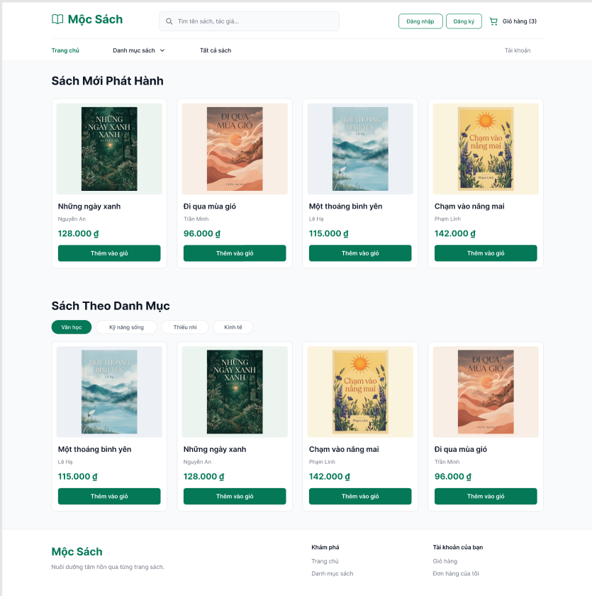
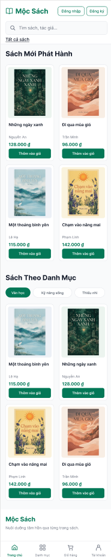

## 5.4.5. Màn hình Chi tiết sách (TM-03)

Màn hình cung cấp đầy đủ thông tin để người đọc cân nhắc trước khi mua.

- **Breadcrumb:** Trang chủ / Văn học / Những ngày xanh.
- **Khối thông tin và đặt mua:** bố cục hai cột. Bên trái là ảnh bìa; bên phải là nhãn danh mục (VĂN HỌC), tên sách, tác giả (Nguyễn An), nhà xuất bản (NXB Văn học), giá bán (128.000 ₫) và số lượng tồn kho (Còn lại: 45). Đi kèm bộ chọn số lượng (−, 1, +) và nút **Thêm vào giỏ hàng**; khách chưa đăng nhập bấm nút này sẽ được chuyển sang trang đăng nhập.
- **Mô tả sản phẩm:** nội dung giới thiệu tác phẩm trong khung thẻ riêng.
- **Đánh giá sản phẩm** _(chức năng cộng điểm TM-09)_: điểm trung bình (4,7 ★) và các đánh giá gồm tên người dùng, số sao, nhận xét.
- **Sách cùng danh mục:** gợi ý các sách cùng chủ đề (Mùa hè năm ấy, Đi qua mùa nhớ, Gió qua hiên nhà, Bình yên ở lại), kèm nút Thêm vào giỏ.

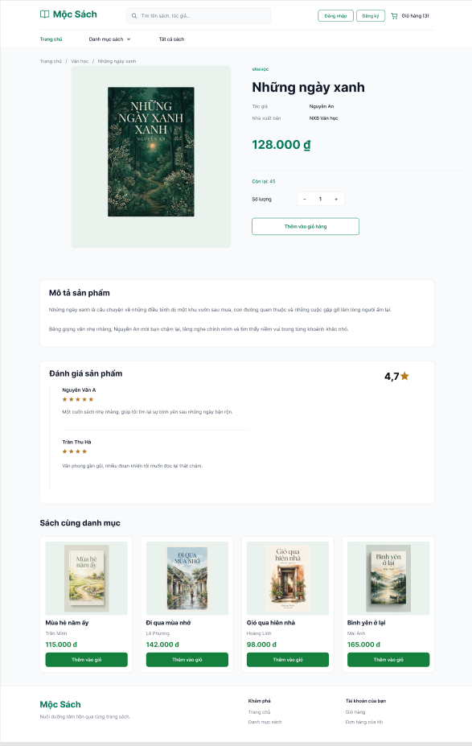
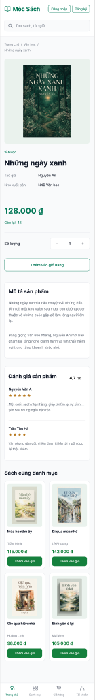

## 5.4.6. Màn hình Giỏ hàng (TM-05)

Giỏ hàng cho phép người dùng kiểm soát sản phẩm và chi phí trước khi đặt hàng.

- **Đầu trang:** breadcrumb Trang chủ / Giỏ hàng và tiêu đề "Giỏ hàng của bạn (3 sản phẩm)".
- **Danh sách sản phẩm:** bảng gồm các cột Sản phẩm, Đơn giá, Số lượng, Thành tiền; có ô chọn từng dòng hoặc chọn tất cả. Mỗi dòng (Những ngày xanh, Đi qua mùa gió, Một thoáng bình yên) có ảnh bìa, tên sách, tác giả, đơn giá, nút tăng/giảm số lượng (−/+), thành tiền và biểu tượng thùng rác để xóa. Phía dưới có dòng "Đã chọn 3 sản phẩm" và liên kết "← Tiếp tục mua sách".
- **Tóm tắt đơn hàng:** ô nhập mã giảm giá và nút Áp dụng _(mã giảm giá là chức năng cộng điểm TM-16)_; các dòng Tạm tính (339.000 ₫), Giảm giá mã MOC15 (−15.000 ₫), Tổng cộng (324.000 ₫, màu xanh đậm) và nút **Tiến hành đặt hàng**.
- **Footer:** như mục 5.4.2.
  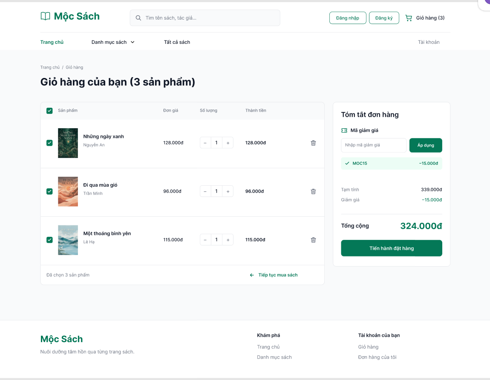
  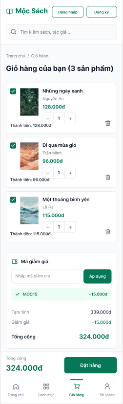

## 5.4.7. Màn hình Đặt hàng (TM-06)

Màn hình tập trung vào việc nhập thông tin nhận hàng và xác nhận thanh toán khi nhận hàng (COD).

- **Đầu trang:** breadcrumb Trang chủ / Giỏ hàng / Đặt hàng và tiêu đề "Đặt hàng".
- **Cột trái – Thông tin giao hàng:** Họ và tên người nhận, Số điện thoại, Địa chỉ giao hàng (có gợi ý mẫu). Các trường sai sẽ báo lỗi tiếng Việt ngay tại trường đó.
- **Cột trái – Phương thức thanh toán:** chỉ có Thanh toán khi nhận hàng (COD) – "Thanh toán bằng tiền mặt khi nhận sách", được làm nổi bằng viền và nền xanh nhạt.
- **Cột phải – Tóm tắt đơn hàng:** danh sách sách đặt mua kèm số lượng (SL: 1) và giá; Tạm tính (339.000 ₫), Giảm giá MOC15 (−15.000 ₫), Phí vận chuyển (Miễn phí), Tổng cộng (324.000 ₫) và nút **Xác nhận đặt hàng**.
- **Kết quả:** sau khi xác nhận, đơn được tạo ở trạng thái "Chờ xác nhận" và giỏ hàng được làm trống.
  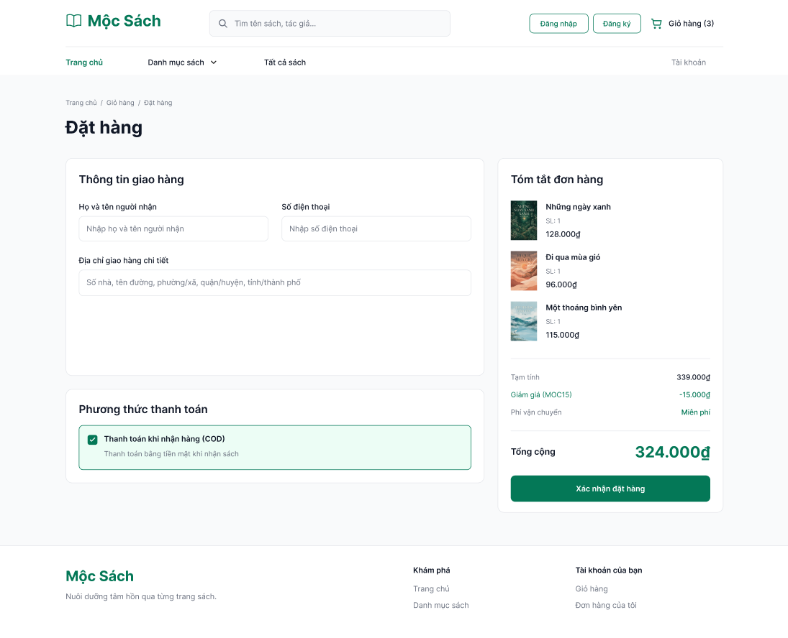
  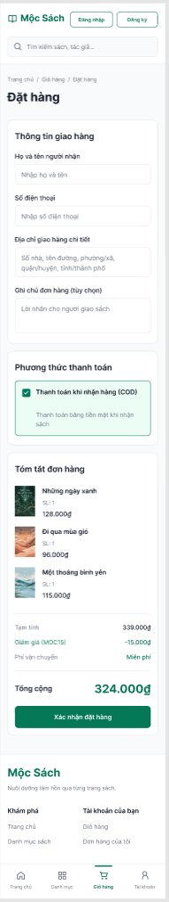

# Quản lý đơn hàng

## 5.4.8. Màn hình Quản lý đơn hàng – Quản trị (TM-13)

- Màn hình giúp quản trị viên theo dõi vòng đời đơn hàng COD và xử lý trực tiếp trên từng thẻ đơn ở cả giao diện desktop lẫn điện thoại.
- Đầu trang và bộ lọc: có breadcrumb Admin / Quản lý đơn hàng, tiêu đề Quản lý đơn hàng, các tab trạng thái gồm Tất cả (24), Chờ xác nhận (5), Đang xử lý (1), Đang giao (8), Hoàn thành (9), Đã hủy (2) và ô tìm kiếm theo mã đơn hoặc SĐT khách hàng.
- Thẻ đơn hàng: mỗi thẻ hiển thị mã đơn (#DH001, #DH002, #DH003), ngày đặt, huy hiệu trạng thái, thông tin người nhận/địa chỉ, hình thức Thanh toán: COD, danh sách sách (ảnh bìa, tên sách, tác giả, số lượng, đơn giá, thành tiền), thông tin mã giảm giá nếu có (như MOC15 (-15.000₫)) và tổng tiền.
- Nút thao tác theo trạng thái: - Đơn Chờ xác nhận có nút Hủy đơn và Xác nhận đơn. - Đơn Đang xử lý có nút Hủy đơn và Giao cho vận chuyển. - Đơn Đang giao có nút Hoàn thành (trên khung nhìn hẹp còn xuất hiện nút Hủy đơn cạnh nút Hoàn thành). - Đơn Hoàn thành chỉ hiển thị thông tin tổng tiền mà không có nút chuyển trạng thái tiếp theo. Responsive & phân trang: trên màn hình hẹp có thanh đầu trang thu gọn kèm nút mở menu và tên quản trị viên, các tab lọc và nút thao tác tự xếp dòng gọn gàng, cùng thanh phân trang (Trước, 1, 2, 3, Sau) ở cuối trang.
  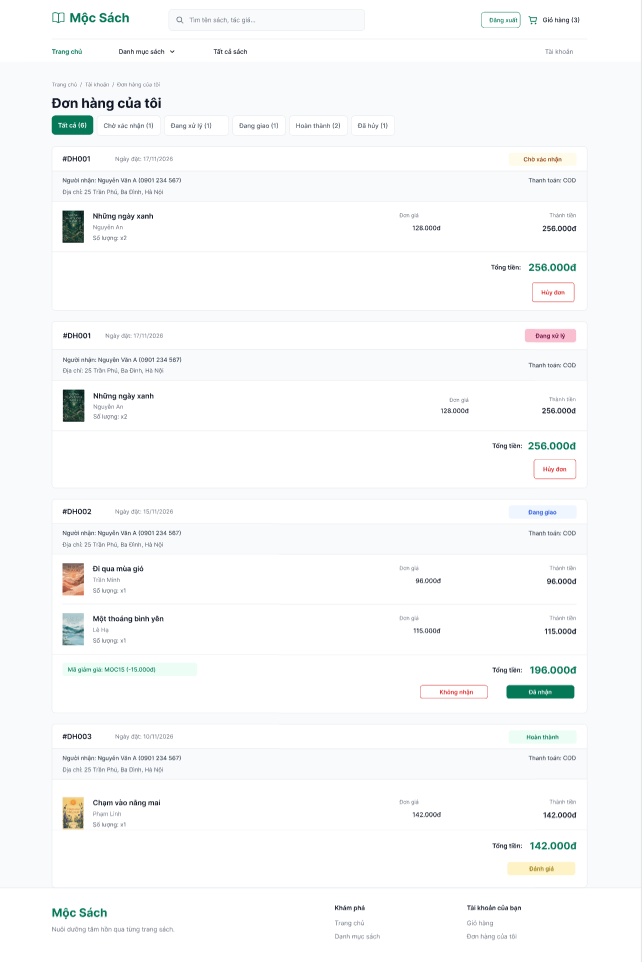
  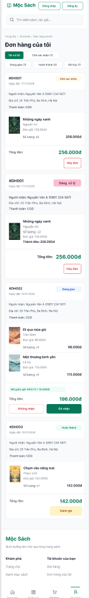

## 5.4.9. Màn hình Quản lý người dùng – Quản trị (TM-14)

Màn hình dạng bảng giúp quản trị viên tra cứu tài khoản, xem vai trò và kiểm soát trạng thái hoạt động.

- **Sidebar và header:** mục Quản lý Người dùng đang chọn; góc phải header hiển thị tài khoản quản trị đang đăng nhập (Lê Minh Anh – Quản trị viên).
- **Tiêu đề và công cụ:** tiêu đề "Quản lý Người dùng", mô tả "Quản lý tài khoản, vai trò và quyền truy cập."; ô tìm kiếm "Tìm theo tên, email, SĐT...", hai bộ lọc (Tất cả vai trò, Tất cả trạng thái) và nút **+ Thêm người dùng**.
- **Bảng danh sách:** hiển thị tổng số tài khoản (846) với các cột Mã, Họ và tên, Email, Số điện thoại, Địa chỉ, Vai trò (Admin, Khách hàng), Trạng thái (Hoạt động, Bị khóa), Ngày tạo, Thao tác. Cột Thao tác có biểu tượng chỉnh sửa, khóa/mở khóa và xóa. Tài khoản bị khóa không đăng nhập được.
- **Phân trang:** các nút Trước, 1, 2, Sau (phân trang phía server).

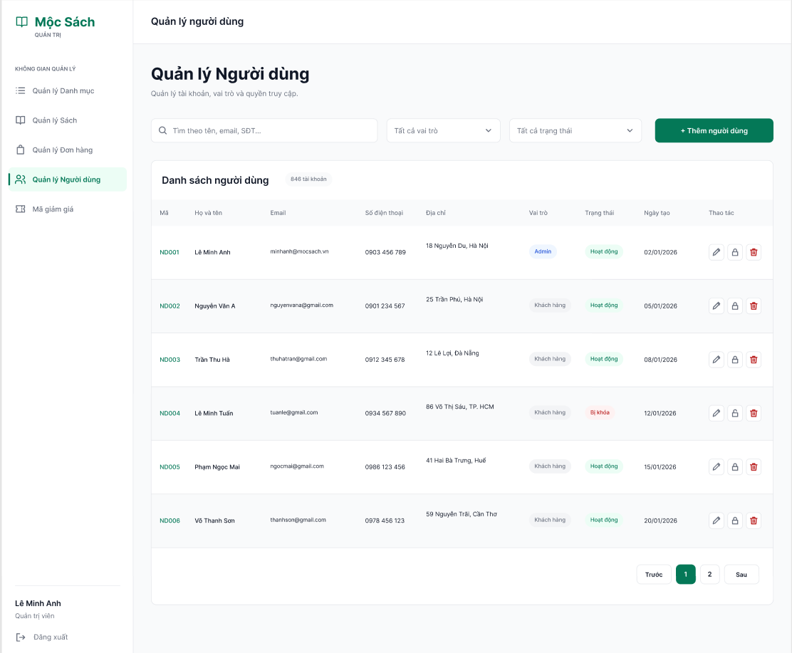
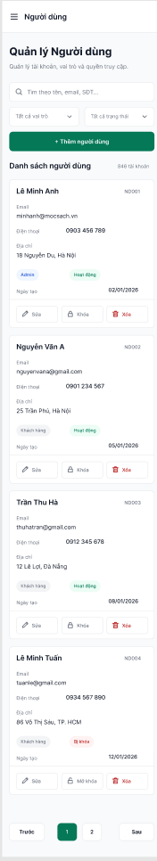
