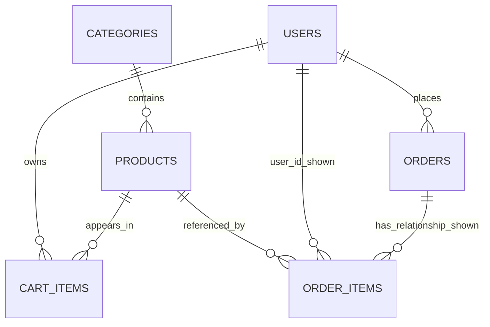

# Mốc 1-Tổng quan và thiết kế hệ thống website bán sách

Môn học:Đồ án Lập trình web
Đề tài: A. Thương mại điện tử – Website bán sách, thanh toán khi nhận hàng (COD)
Nhóm: 05 thành viên
Phiên bản tài liệu: Mốc 1
Trạng thái: Bản tổng hợp thiết kế; các điểm cần chốt được đánh dấu ở phần ghi chú.

## 1 Giới thiệu đề tài

### 1.1 Mô tả

Xây dựng website thương mại điện tử bán sách.Người dùng có thể xem trang chủ,tìm kiếm và lọc sách,xem thông tin chi tiết,đăng ký/đăng nhập,quản lý giỏ hàng và đặt hàng theo phương thức thanh toán COD. Khách hàng có thể theo dõi đơn hàng và quản lý hồ sơ cá nhân. Quản trị viên quản lý danh mục,sản phẩm,đơn hàng,người dùng,chương trình giảm giá.

### 1.2 Mục tiêu

-Cung cấp quy trình mua sách trực tuyến từ xem sản phẩm đến tạo đơn COD.
-Quản lý tập trung thông tin sách,danh mục,người dùng và đơn hàng.
-Kiểm soát đăng nhập,phân quyền và dữ liệu phía server.
-Đảm bảo số lượng tồn kho,giá bán tại thời điểm đặt hàng.
-Tổ chức mã nguồn và công việc nhóm bằng Github và Trello.

### 1.3 Tác nhân

-Khách vãng lai: Xem trang chủ,tìm kiếm/lọc sách,xem chi tiết sản phẩm,đăng ký,đăng nhập.
-Khách hàng: Kế thừa các chức năng khách vãng lai,quản lý giỏ hàng,đặt hàng COD,xem/hủy đơn,quản lý hồ sơ cá nhân,đánh giá sản phẩm,đăng xuất.
-Quản trị viên: Đăng nhập/Đăng xuất;quản lý danh mục,sản phẩm,đơn hàng,người dùng,giảm giá.

### 1.4 Phạm vi nghiệp vụ

<b>Trong phạm vi:</b> bán sách;tài khoản với vai trò customer và admin;giỏ hàng;đặt hàng COD;quản lý danh mục/sản phẩm/đơn hàng/người dùng;đánh giá sản phẩm;mã giảm giá 
<b>Ngoài phạm vi:</b> thanh toán trực tuyến qua cổng thanh toán.

## 2 Công nghệ sử dụng

<b>Frontend:</b> React 
<b>Vai trò/ghi chú:</b> Giao diện website chạy trên trình duyệt theo hướng SPA. 
<b>Backend:</b> Laravel(PHP) 
<b>Vai trò/ghi chú:</b> Xử lý request, controller, middleware, nghiệp vụ và truy cập dữ liệu. 
<b>Database:</b> MySQL 
<b>Vai trò/ghi chú:</b> Lưu tài khoản, danh mục, sản phẩm, giỏ hàng, đơn hàng, chi tiết đơn và voucher. 
<b>Mô hình truy cập dữ liệu:</b> Laravel Models/ORM 
<b>Vai trò/ghi chú:</b> Ánh xạ dữ liệu và thao tác với MySQL theo tầng Models trong sơ đồ. 
<b>Quản lý mã nguồn:</b> Git/Github 
<b>Vai trò/ghi chú:</b> Tạo branch theo chức năng, commit, pull request, review và merge vào develop. 
<b>Quản lý công việc:</b> Trello 
<b>Vai trò/ghi chú:</b> Theo dõi Backlog, công việc đang làm, hoàn thành và tiến độ từng thành viên. 

## 3 Kiến trúc hệ thống

### 3.1 Mô hình kiến trúc

Browser-->Controllers-->Services-->Models-->MySQL

### 3.2 Trách nhiệm từng phần

<b>Browser:</b> Hiển thị giao diện React;Nhận thao tác từ người dùng;gửi request đến backend và hiển thị lỗi.
<b>Controllers:</b> Tiếp nhận request,đọc input,gọi Service phù hợp và trả response cho frontend.
<b>Service:</b> Xử lý nghiệp vụ,kiểm tra quyền theo luồng.
<b>Models:</b> Đại diện cho dữ liệu quan hệ,thực hiện truy vấn qua ORM.
<b>MySQL:</b> Lưu trữ dữ liệu:áp dụng khóa chính,khóa ngoại,các ràng buộc.

### 3.3 Luồng xử lý tổng quát

1. Người dùng thao tác trên giao diện React trong Browser.
2. Frontend gửi HTTP request đến backend.
3. Middleware kiểm tra trạng thái đăng nhập. CSRF và quyền truy cập.
4. Controller tiếp nhận request, kiểm tra/nhận dữ liệu đầu vào và gọi Service.
5. Service thực hiện nghiệp vụ, sử dụng Model để đọc/ghi dữ liệu.
6. Model truy cập MySQL;kết quả được trả ngược qua Service và Controller.
7. Controller trả HTTP response(thường là JSON đối với API);React cập nhật giao diện.

### 3.4 Các quy tắc bảo mật và xử lý dữ liệu

-Kiểm tra dữ liệu và quyền truy cập ở server.
-Mật khẩu lưu dưới dạng mã hash bcrypt; không lưu mật khẩu gốc.
-Lỗi đăng nhập do email không tồn tại hoặc sai mật khẩu dùng thông báo chung.
-Tối đa 7 lần nhập sai,tạm chặn 3 phút.
-Người dùng chưa đăng nhập nhưng thực hiện các chức năng dính đến đăng nhập đều bị chuyển về trang đăng nhập.
-Truy vấn tìm kiếm phải truyền tham số.
-Nội dung do người dùng nhập phải được làm sạch/escapse hạn chế XSS.
-Ảnh sản phẩm chỉ nhận JPG/PNG tối đa 2MB;kiểm tra nội dung tệp,đặt tên lưu trữ ngẫu nhiên.
-Đặt hàng phải dùng transaction;kiểm tra tồn kho và giá lần cuối trong transaction;khóa sản phẩm theo thứ tự id tăng dần.
-Mã chống gửi trùng phải ngăn 1 thao tác xác nhận tạo nhiều đơn hàng.
-Lỗi hệ thống không hiển thị chi tiết kĩ thuật cho người dùng và phải được ghi log phía server.
-Đặt tả quy ước thử lại sau deadlock tối đa 2 lần

## 4 Thiết kế cơ sở dữ liệu

### 4.1 Các thực thể và thuộc tính đang thể hiện trong ERD

| Bảng          | Khóa chính      | Thuộc tính khác thể hiện trên ERD                                                                                                                                           |
| ------------- | --------------- | --------------------------------------------------------------------------------------------------------------------------------------------------------------------------- |
| `users`       | `user_id`       | `full_name`, `email`, `password`, `role`, `address`, `phone`, `created_at`, `updated_at`, `deleted_at`                                                                      |
| `categories`  | `category_id`   | `category_name`, `description`, `slug`, `created_at`, `updated_at`, `deleted_at`                                                                                            |
| `products`    | `product_id`    | `product_name`, `description`, `price`, `stock`, `author`, `publisher_name`, `image`, `slug`, `category_id (FK)`, `created_at`, `updated_at`, `deleted_at`                  |
| `cart_items`  | `cart_id`       | `quantity`, `user_id (FK)`, `product_id (FK)`, `created_at`, `updated_at`, `deleted_at`                                                                                     |
| `orders`      | `order_id`      | `user_id (FK)`, `status`, `recipient_name`, `recipient_phone`, `shipping_address`, `order_date`, `total_amount`, `payment_method`, `created_at`, `updated_at`, `deleted_at` |
| `order_items` | `order_item_id` | `user_id (FK)`, `product_id (FK)`, `quantity`, `unit_price`, `subtotal`, `created_at`, `deleted_at`                                                                         |
| `voucher`     | `voucher_id`    | `code`, `discount_amount`, `expired_date`, `created_at`, `updated_at`, `deleted_at`                                                                                         |

### 4.2 Quan hệ dữ liệu

-Một danh mục có thể chứa nhiều sản phẩm; mỗi sản phẩm tham chiếu danh mục qua products.category_id.
-Một người dùng có thể nhiều dòng giỏ hàng;cart_items tham chiếu người dùng và sản phẩm.
-Một người dùng có thể nhiều đơn hàng;orders.user_id tham chiếu users.
-order_items lưu sản phẩm, số lượng, đơn giá và thành tiền của dòng hàng.
-ERD có thể hiện quan hệ rating với hai thuộc tính star và comment, cùng quan hệ apply giữa voucher và đơn hàng

## 5 Danh sách User Story

Danh sách dưới đây tổng hợp các chức năng TM-xx trên Use Case Diagram. Các mã chức năng được giữ theo sơ đồ để tiện liên kết Trello, Git branch và test case.

| ID     | Mã chức năng | Actor                              | User Story                                                                                                      |
| ------ | ------------ | ---------------------------------- | --------------------------------------------------------------------------------------------------------------- |
| US-01  | TM-01        | Khách vãng lai/Khách hàng          | Là người truy cập website, tôi muốn xem trang chủ để biết các sách và nội dung đang được giới thiệu.            |
| US-02  | TM-02        | Khách vãng lai/Khách hàng          | Là người mua sách, tôi muốn tìm kiếm và lọc sách để nhanh chóng tìm được sản phẩm phù hợp.                      |
| US-03  | TM-03        | Khách vãng lai/Khách hàng          | Là người mua sách, tôi muốn xem chi tiết sản phẩm để biết thông tin trước khi quyết định mua.                   |
| US-04a | TM-04a       | Khách vãng lai/Khách hàng/Quản trị | Là người đã có tài khoản, tôi muốn đăng nhập bằng email và mật khẩu để sử dụng chức năng theo vai trò của mình. |
| US-04b | TM-04b       | Khách vãng lai                     | Là khách mới, tôi muốn đăng ký tài khoản để trở thành khách hàng và đặt mua sách.                               |
| US-04c | TM-04c       | Khách hàng/Quản trị                | Là người đã đăng nhập, tôi muốn đăng xuất để kết thúc phiên làm việc an toàn.                                   |
| US-05  | TM-05        | Khách hàng                         | Là khách hàng, tôi muốn xem và quản lý giỏ hàng để thay đổi số lượng hoặc xóa sách trước khi đặt hàng.          |
| US-05a | TM-05a       | Khách hàng                         | Là khách hàng, tôi muốn thêm sách vào giỏ hàng từ trang chi tiết sản phẩm để mua sau hoặc đặt hàng.             |
| US-06  | TM-06        | Khách hàng                         | Là khách hàng, tôi muốn đặt hàng và thanh toán COD để nhận sách rồi thanh toán khi giao hàng.                   |
| US-07  | TM-07        | Khách hàng                         | Là khách hàng, tôi muốn xem danh sách và chi tiết đơn hàng của mình để theo dõi tình trạng mua hàng.            |
| US-07a | TM-07a       | Khách hàng                         | Là khách hàng, tôi muốn hủy đơn hàng khi đơn còn đủ điều kiện hủy.                                              |
| US-08  | TM-08        | Khách hàng                         | Là khách hàng, tôi muốn xem/cập nhật hồ sơ cá nhân để quản lý thông tin tài khoản.                              |
| US-09  | TM-09        | Khách hàng                         | Là khách hàng, tôi muốn đánh giá sách bằng số sao và bình luận để chia sẻ nhận xét về sản phẩm.                 |
| US-11  | TM-11        | Quản trị                           | Là quản trị viên, tôi muốn thêm, xem, sửa và xóa/quản lý danh mục để tổ chức sách theo nhóm.                    |
| US-12  | TM-12        | Quản trị                           | Là quản trị viên, tôi muốn thêm, xem, sửa, xóa và ẩn/hiện sách để quản lý danh mục sản phẩm đang bán.           |
| US-13  | TM-13        | Quản trị                           | Là quản trị viên, tôi muốn xem và quản lý đơn hàng để xử lý các đơn do khách hàng tạo.                          |
| US-14  | TM-14        | Quản trị                           | Là quản trị viên, tôi muốn quản lý người dùng để kiểm soát tài khoản và trạng thái hoạt động.                   |
| US-16  | TM-16        | Quản trị                           | Là quản trị viên, tôi muốn quản lý mã giảm giá để tạo và kiểm soát chương trình khuyến mãi.                     |
| US-16a | TM-16a       | Khách hàng                         | Là khách hàng, tôi muốn áp dụng mã giảm giá khi đặt hàng để được giảm số tiền hợp lệ.                           |

### 5.1 Use case đã có đặc tả chi tiết

Tài liệu `use-case.md` hiện đặc tả chi tiết ba nghiệp vụ:

- **UC-01 – Đăng nhập (TM-04a):** xác thực email/mật khẩu, giới hạn lần nhập sai, kiểm tra tài khoản bị khóa, tạo phiên/token và điều hướng theo vai trò; có luồng đăng ký, quay lại trang trước và đăng xuất.
- **UC-02 – Quản lý sản phẩm (TM-12):** thêm, tìm kiếm, sửa, ẩn/hiện, xóa mềm/xóa sản phẩm; kiểm tra dữ liệu, ảnh và quyền admin ở server.
- **UC-03 – Đặt hàng COD (TM-06):** kiểm tra giỏ hàng, thông tin nhận hàng, tồn kho và giá; tạo `orders`/`order_items` trong transaction, trừ tồn kho và chống gửi trùng.

Các User Story còn lại đã có trên Use Case Diagram nhưng chưa có đặc tả luồng chính/luồng ngoại lệ đầy đủ trong tài liệu được cung cấp.

## 6. Kế hoạch Sprint S2

### 6.1. Sprint Goal

Hoàn thiện luồng mua sách cốt lõi từ xem/tìm kiếm sản phẩm → đăng ký/đăng nhập → quản lý giỏ hàng → đặt hàng COD → xem đơn hàng; đồng thời xây dựng các chức năng quản trị danh mục, sản phẩm, đơn hàng và người dùng. Các chức năng phải được kiểm tra quyền ở backend và tích hợp vào nhánh `develop`.

### 6.2. Sprint Backlog và phân công

Phân công chức năng giữ theo bảng phân công 5 thành viên trong tài liệu hướng dẫn:

| Thành viên                    | Chức năng trong S2  | Công việc chính                                                                          | Kết quả cần bàn giao                                                                                              |
| ----------------------------- | ------------------- | ---------------------------------------------------------------------------------------- | ----------------------------------------------------------------------------------------------------------------- |
| **TV1 – PM/Scrum Master**     | TM-08, TM-14        | Hồ sơ cá nhân; quản lý người dùng; kiểm tra quyền và trạng thái tài khoản ở phía server. | Màn hình/API hồ sơ; màn hình/API danh sách và cập nhật người dùng; kiểm thử quyền admin.                          |
| **TV2 – Backend lead**        | TM-04, TM-06        | Đăng ký, đăng nhập, đăng xuất, phân quyền; xử lý đặt hàng COD.                           | API xác thực; middleware/role; luồng tạo đơn COD có transaction, lưu giá lúc mua, trừ tồn kho và chống gửi trùng. |
| **TV3 – Frontend lead**       | TM-01, TM-02, TM-03 | Trang chủ; giao diện tìm kiếm/lọc; trang chi tiết sách.                                  | Các màn hình React kết nối API, trạng thái loading/empty/error và điều hướng đến chi tiết sản phẩm.               |
| **TV4 – Cơ sở dữ liệu**       | TM-11, TM-12        | Quản lý danh mục và sản phẩm; hoàn thiện migration/quan hệ dữ liệu tương ứng.            | CRUD danh mục/sản phẩm; tìm kiếm và phân trang quản trị; kiểm tra ảnh; đồng bộ ERD với migration.                 |
| **TV5 – Git & kiểm thử (QA)** | TM-05, TM-07, TM-13 | Quản lý giỏ hàng; xem/hủy đơn của khách; quản lý đơn hàng ở admin.                       | Chức năng giỏ hàng; trang đơn hàng của tôi; màn hình/API quản trị đơn hàng; test luồng và test phân quyền.        |

**Các chức năng chưa có người phụ trách trong bảng phân công bắt buộc:** TM-09 (đánh giá sản phẩm), TM-16 (quản lý giảm giá), TM-16a (áp dụng mã giảm giá). Đưa các chức năng này vào Backlog chờ nhóm phân công hoặc đưa sang Sprint tiếp theo; không tự gán người phụ trách khi chưa thống nhất.

### 6.3. Thứ tự ưu tiên và phụ thuộc

| Thứ tự | Nhóm chức năng                          | Phụ thuộc chính                                                                                                     |
| ------ | --------------------------------------- | ------------------------------------------------------------------------------------------------------------------- |
| 1      | TM-04 – Đăng ký/đăng nhập/đăng xuất     | Cần thống nhất cơ chế auth, API contract và middleware trước khi tích hợp các chức năng yêu cầu đăng nhập.          |
| 2      | TM-11, TM-12 – Danh mục và sản phẩm     | Danh mục cần sẵn sàng trước khi thêm/sửa sản phẩm; dữ liệu sản phẩm là đầu vào cho trang chủ, tìm kiếm và chi tiết. |
| 3      | TM-01, TM-02, TM-03 – Duyệt và tìm sách | Phụ thuộc API/dữ liệu sản phẩm; TM-03 là điểm vào của thao tác thêm giỏ.                                            |
| 4      | TM-05 – Giỏ hàng                        | Phụ thuộc đăng nhập và dữ liệu sản phẩm; phải kiểm soát quyền sở hữu giỏ hàng theo user hiện tại.                   |
| 5      | TM-06 – Đặt hàng COD                    | Phụ thuộc TM-04 và TM-05; cần transaction, khóa tồn kho, lưu giá tại thời điểm mua.                                 |
| 6      | TM-07, TM-13 – Quản lý đơn hàng         | TM-07 phụ thuộc đơn hàng của khách; TM-13 cần dữ liệu đơn đã tạo và quyền admin.                                    |
| 7      | TM-08, TM-14 – Hồ sơ và người dùng      | TM-08 cần xác thực; TM-14 chỉ admin được truy cập. Có thể phát triển song song với các nhóm trên.                   |

### 6.4. Lịch thực hiện đề xuất

| Ngày                                       | Trọng tâm                                                                                                                                                  | Kết quả cuối ngày                                                                                    |
| ------------------------------------------ | ---------------------------------------------------------------------------------------------------------------------------------------------------------- | ---------------------------------------------------------------------------------------------------- |
| **Ngày 1 – Refinement**                    | Rà acceptance criteria; chốt API contract; rà ERD/migration và cơ chế xác thực; tạo thẻ S2 và branch theo chức năng.                                       | Backlog S2 có mô tả, người phụ trách, tiêu chí hoàn thành và phụ thuộc rõ ràng.                      |
| **Ngày 2 – Phát triển nền tảng**           | TV2 triển khai auth; TV4 triển khai danh mục/sản phẩm và dữ liệu; TV3 dựng trang chủ/tìm kiếm/chi tiết; TV1 và TV5 dựng cấu trúc hồ sơ, giỏ hàng/đơn hàng. | Các nhánh chức năng có phần backend/frontend nền tảng chạy độc lập.                                  |
| **Ngày 3 – Hoàn thiện chức năng mua sách** | Tích hợp danh sách/chi tiết sách; hoàn thiện giỏ hàng; hồ sơ người dùng; quản trị danh mục/sản phẩm; bắt đầu tích hợp luồng checkout.                      | Người dùng có thể duyệt sách, đăng nhập và thao tác giỏ hàng trên môi trường tích hợp.               |
| **Ngày 4 – Đặt hàng và quản trị đơn**      | Hoàn thiện COD; xem đơn của tôi; quản lý đơn hàng admin; kiểm thử phân quyền, tồn kho, dữ liệu nhận hàng và chống gửi trùng.                               | Luồng tạo đơn COD và tra cứu/quản trị đơn hàng hoạt động trên `develop`.                             |
| **Ngày 5 – Integration & Review**          | Chạy test end-to-end; sửa lỗi; review PR; kiểm tra migration/seed/README; merge các nhánh đã duyệt và chuẩn bị demo Sprint.                                | `develop` chạy được từ đầu theo hướng dẫn; có kết quả test, danh sách lỗi còn lại và demo Sprint S2. |

### 6.5. Tiêu chí nghiệm thu Sprint S2

- [ ] Khách vãng lai xem được trang chủ, tìm kiếm/lọc và xem chi tiết sách.
- [ ] Người dùng đăng ký, đăng nhập và đăng xuất được; điều hướng theo vai trò đúng.
- [ ] Người chưa đăng nhập không thể gọi chức năng yêu cầu đăng nhập; người không phải admin không truy cập được chức năng quản trị.
- [ ] Khách hàng chỉ xem/thay đổi giỏ hàng và đơn hàng thuộc tài khoản của mình.
- [ ] Có thể tạo đơn COD hợp lệ; server tự tính tổng tiền; `order_items` lưu đơn giá tại thời điểm mua.
- [ ] Khi tồn kho không đủ hoặc giá/giỏ thay đổi, hệ thống không tạo đơn sai; transaction rollback đúng.
- [ ] Request xác nhận lặp lại không tạo đơn trùng.
- [ ] Admin quản lý được danh mục, sản phẩm, đơn hàng và người dùng theo phạm vi chức năng được giao.
- [ ] Dữ liệu đầu vào được validate ở server; lỗi hiển thị bằng tiếng Việt; lỗi hệ thống được ghi log.
- [ ] Migration chạy được trên MySQL; ERD và tài liệu mô tả bảng khớp với cấu trúc thực tế.
- [ ] Các PR đã được review và merge vào `develop`; không merge code chưa kiểm thử.
- [ ] README có hướng dẫn cài đặt, cấu hình môi trường, migrate/seed và tài khoản demo phù hợp.

### 6.6. Quy trình Trello và Git trong Sprint

**Trello**

- Tạo trước các thẻ S2 ở Backlog, mỗi thẻ có mã TM, mô tả, người phụ trách và checklist nghiệm thu.
- Khi bắt đầu, kéo thẻ sang cột đang làm; khi mở PR chuyển sang trạng thái review; chỉ chuyển Hoàn thành sau khi merge và kiểm thử đạt.
- Cuối buổi, mỗi thành viên cập nhật một dòng tiến độ và ghi rõ blocker nếu có.

**Git/GitHub**

- Cập nhật `develop` trước khi tạo branch.
- Đặt branch theo chức năng, ví dụ: `feature/TM-06-dat-hang-cod`, `feature/TM-12-quan-ly-san-pham`.
- Commit ngắn gọn, có mã chức năng; tạo PR về `develop`, mô tả phần thay đổi và cách kiểm thử.
- PR cần có reviewer; xử lý conflict và chạy lại test trước khi merge.
- Không commit file `.env`, mật khẩu, token hoặc dữ liệu nhạy cảm.

---

## 7. Tài liệu và sản phẩm bàn giao Mốc 1

Theo hướng dẫn Ngày 4 – Thứ 5, tuần 1, bộ tài liệu Mốc 1 trong `docs/` cần có các nội dung sau:

- [ ] Tài liệu tổng quan Mốc 1: `docs/moc-1.md`.
- [ ] Đề cương/đặc tả yêu cầu.
- [ ] Use Case Diagram và đặc tả các use case.
- [ ] Sequence Diagram.
- [ ] ERD final khớp migration: `docs/database/erd-final.png`.
- [ ] Mô tả bảng: `docs/database/mo-ta-bang.md`.
- [ ] Sơ đồ kiến trúc.
- [ ] Wireframe/giao diện đã có.
- [ ] Cấu trúc thư mục: `docs/cau-truc-thu-muc.md`.
- [ ] README có hướng dẫn cài đặt, migrate/seed và tài khoản demo.
- [ ] AI log: mỗi thành viên tối thiểu 2 mục theo yêu cầu của hướng dẫn Mốc 1.

### 7.1. Phân công trình bày Mốc 1

| Người trình bày | Nội dung                       |
| --------------- | ------------------------------ |
| TV1             | Tổng quan đề tài và Trello.    |
| TV2             | Kiến trúc hệ thống.            |
| TV4             | ERD và thiết kế cơ sở dữ liệu. |
| TV3             | Wireframe/giao diện.           |
| TV4             | Git/GitHub và AI log.          |

Thời lượng trình bày dự kiến khoảng **10 phút** theo hướng dẫn môn học.
